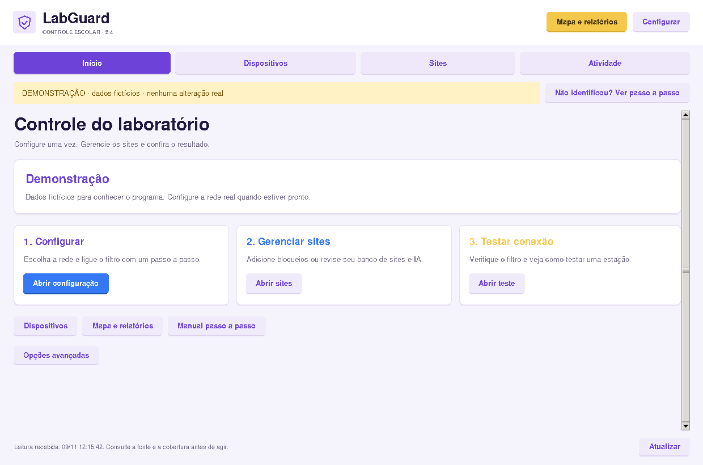

# LabGuard 1.3.0

Interface gráfica em Python para administrar o acesso à internet de um laboratório escolar. O painel abre em **demonstração identificada**, com dados fictícios, sem alterar a rede.

Identidade visual em roxo, azul e amarelo, com cards arredondados, botões visuais e atalhos para as tarefas do laboratório.

[Site promocional](https://perabru.github.io/LabGuard/) · [Downloads Windows](https://github.com/perabru/LabGuard/releases/latest) · [Guia Windows](docs/INSTALACAO_WINDOWS.md)



Na operação completa, um gateway Linux dedicado aplica as regras entre o roteador e as máquinas. Essa estrutura funciona com um TP-Link comum porque o gateway controla o tráfego. As integrações diretas com equipamentos TP-Link, Cisco ou fornecidos pela Embratel dependem do modelo, firmware e API disponíveis; cada adaptador informa as operações que suporta. Consulte [integrações e compatibilidade](docs/INTEGRACOES.md).

## O que está incluído

| Recurso | Funcionamento |
|---|---|
| Máquinas observadas | Junta concessões DHCP e vizinhos de rede, com IP, MAC e nome disponível |
| Cortar/restaurar internet | Regra de encaminhamento por máquina; endereços de administração protegidos |
| Mudanças de IP | O gateway atualiza periodicamente a associação IP/MAC, mesmo com o painel fechado |
| Bloquear sites | Lista de domínios e subdomínios aplicada ao DNS de todo o laboratório |
| Bloquear serviços de IA | Controle global para ativar/desativar o catálogo de domínios de IA, preservando a lista manual |
| Novos domínios | Cadastro e remoção pela interface; não depende de recompilar o programa |
| Histórico DNS | Consultas por IP, filtro por máquina e exportação CSV |
| Conexões | IP de destino, protocolo, porta e estado disponibilizados pelo conntrack |
| Auditoria | Registro das alterações efetuadas pelo painel |
| Acesso ao gateway | OpenSSH com chave, host previamente verificado e comando remoto limitado |

## Instalar no Windows

Baixe `LabGuard-Setup.exe` na página de versões. O instalador inclui o Python e os recursos do painel; não é necessário instalar Python separadamente. Ele cria atalhos e oferece desinstalação. A versão portátil está em `LabGuard-Portable.zip`.

O instalador do painel não configura o gateway nem habilita automaticamente o acesso administrativo aos roteadores. Consulte [as instruções de instalação e uso no Windows](docs/INSTALACAO_WINDOWS.md).

## Executar pelo código-fonte

Instale Python 3.10 ou superior com Tcl/Tk. No Windows, abra `iniciar.bat`; no Linux, execute:

```bash
python3 main.py
```

No Debian/Ubuntu, caso o módulo Tk não esteja instalado:

```bash
sudo apt install python3-tk
```

A interface usa a biblioteca padrão do Python. A conexão real também exige o cliente OpenSSH (`ssh`) no computador do professor. No Windows ele pode ser habilitado em Recursos opcionais → Cliente OpenSSH.

## Colocar em operação

Leia [o guia de instalação](docs/INSTALACAO.md). É necessário um computador Linux dedicado com duas interfaces de rede e uma sub-rede isolada para o laboratório. **Instalar somente o painel no Windows não permite cortar a internet dos outros computadores.**

A instalação deve começar com uma única máquina de teste. Depois de verificar DHCP, DNS, bloqueio e restauração, conecte as demais máquinas.

O bloqueio por catálogo de IA começa **desativado no gateway**. Ative-o pelo painel para aplicá-lo ao laboratório inteiro. A lista cobre os serviços cadastrados e pode receber novos domínios; ela não identifica toda IA incorporada em sites ou executada localmente.

## Roteadores, switches e novos fabricantes

Use **Roteadores / switches** no menu lateral para abrir a central de integrações diretas. Ela oferece perfis com capacidades explícitas para Cisco IOS/IOS XE, TP-Link JetStream compatível, MikroTik RouterOS 7 e OpenWrt. Os perfis de consulta e os de controle de portas são identificados na própria central; não há promessa de suporte universal por marca.

Também é possível importar um perfil declarativo JSON/ZIP ou baixar um perfil por HTTPS com SHA-256 obrigatório. Não são executados instaladores, código Python ou dependências vindas de perfis. Equipamentos da Embratel exigem identificar o fabricante e modelo reais. Consulte [o guia de integrações](docs/INTEGRACOES.md) antes de operar uma porta.

## Entenda os dados

Uma consulta DNS pode vir de uma página, aplicativo ou serviço em segundo plano. Ela não comprova uma visita, não apresenta a URL completa e não mostra conteúdo HTTPS. O inventário reúne máquinas observadas, sem prometer detectar todos os equipamentos fisicamente conectados. Consulte [alcance e limitações](docs/ALCANCE.md).

## Verificação do código

```bash
python3 -m unittest discover -s tests -v
```

Os testes automatizados verificam validações e comportamento usando simulação. A validação de tráfego real precisa ser feita na topologia do laboratório, conforme o guia.

## Estrutura

| Caminho | Conteúdo |
|---|---|
| `main.py` | Inicia a interface |
| `labguard/` | Interface, demonstração e transporte SSH |
| `gateway/agent.py` | Aplicação das regras e coleta no Linux |
| `gateway/ai_services.json` | Catálogo de domínios usado pela política de IA |
| `gateway/install.sh` | Instalador do gateway Debian/Ubuntu |
| `gateway/config.example.json` | Modelo de configuração a adaptar |
| `docs/` | Instalação, operação, limites e recuperação |
| `tests/` | Testes automatizados sem alterar a rede |
| `website/` | Site promocional estático publicado no GitHub Pages |
| `packaging/` e `scripts/build_windows.ps1` | Recursos do instalador e compilação Windows |
