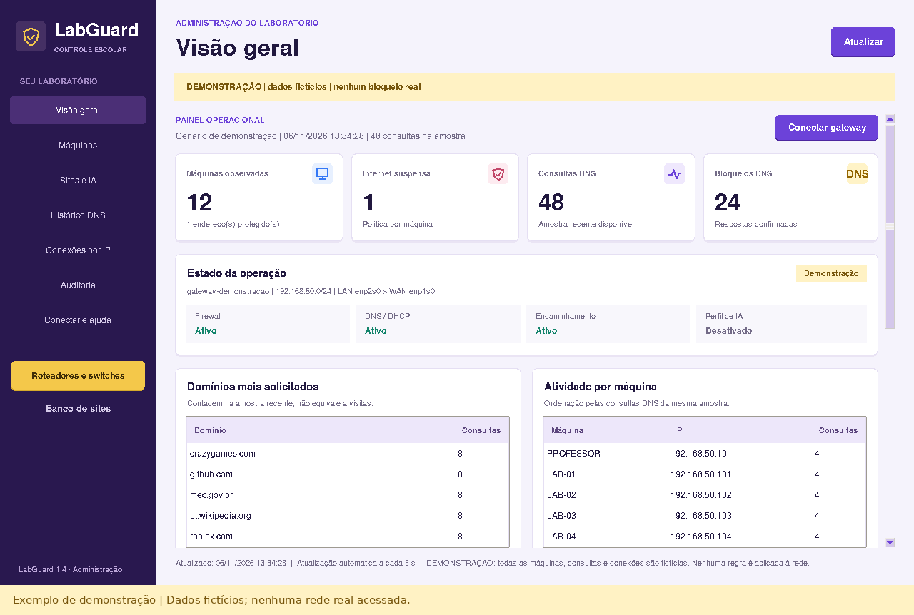
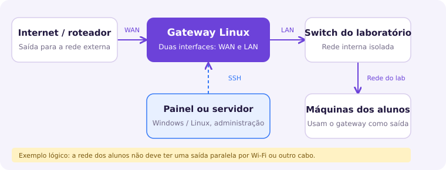
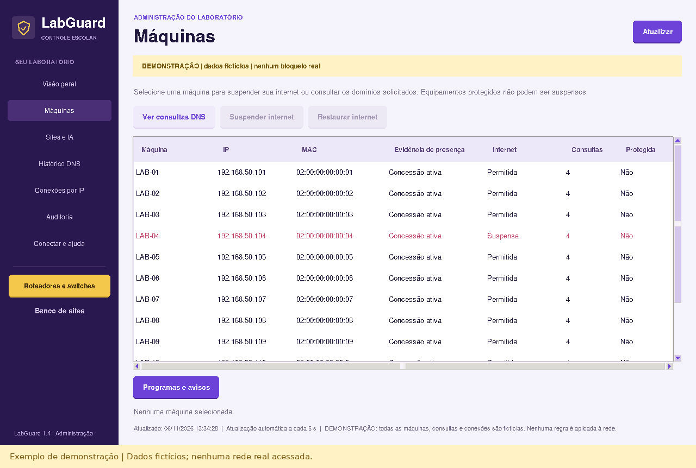
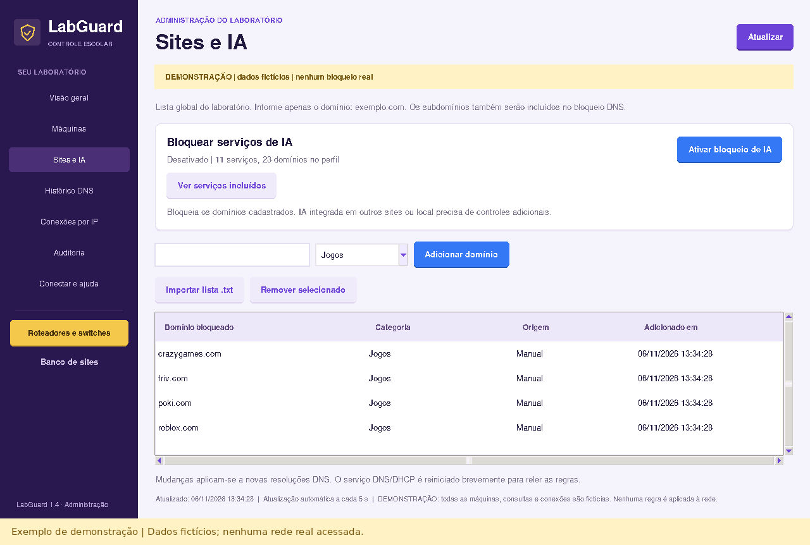
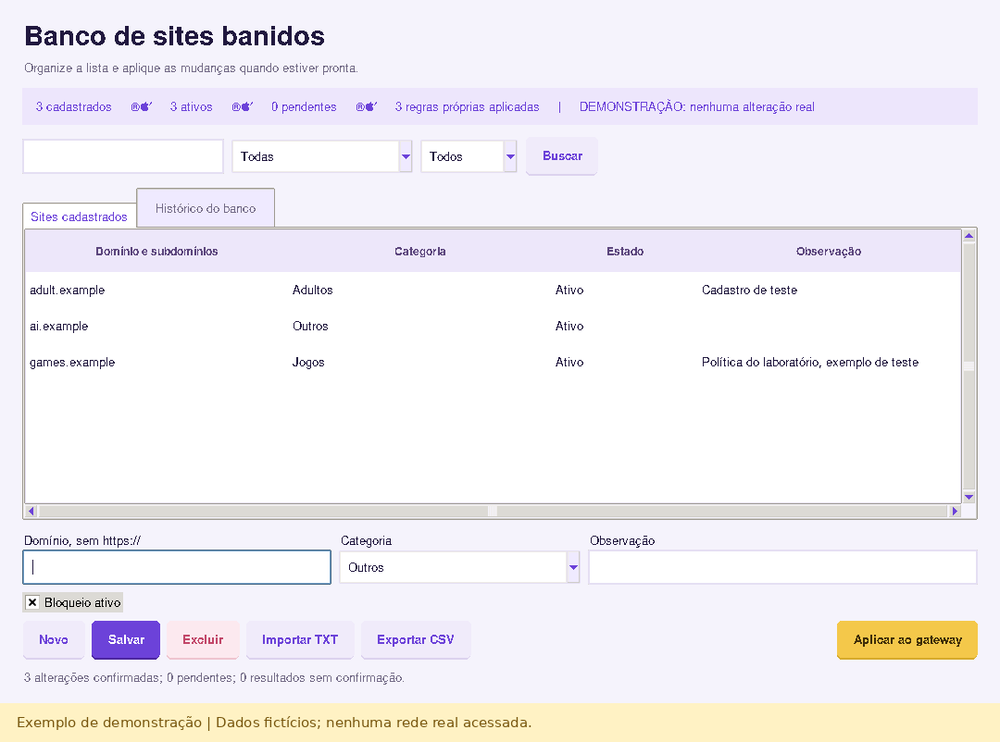
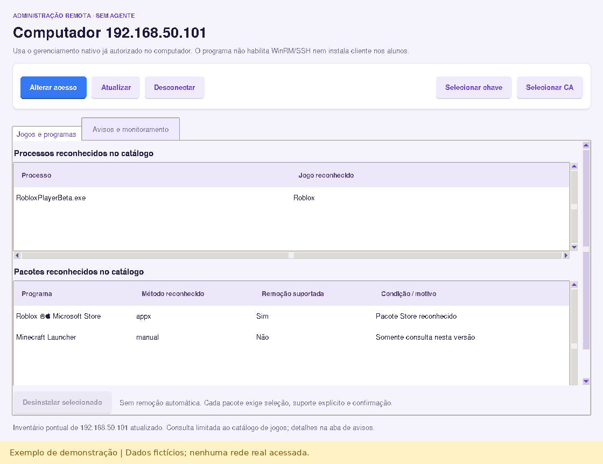
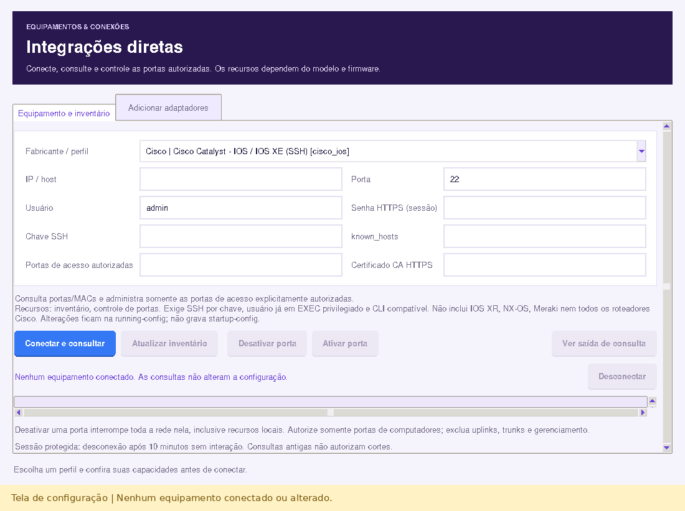
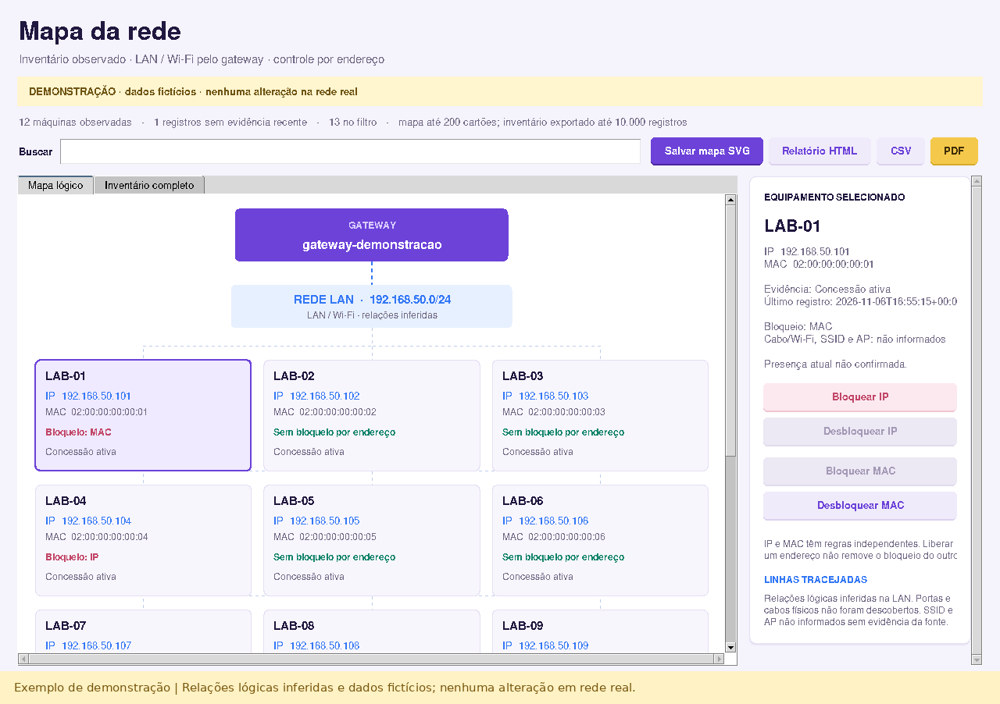

# Manual do usuário — LabGuard 1.4.0

**Administração do laboratório escolar · Windows, Linux e servidores**  
Edição de 6 de novembro de 2026. Identidade visual: roxo, azul e amarelo.

Este manual orienta professores, operadores e responsáveis de TI desde a escolha do pacote até a recuperação de uma instalação. Os exemplos usam uma rede fictícia e precisam ser adaptados pela TI. Telas de demonstração contêm dados inventados e não comprovam bloqueios em uma rede real.

O código desta edição está em validação para publicação. Confira os pacotes efetivamente disponíveis e o estado dos testes em [Versões e downloads](https://github.com/perabru/LabGuard/releases) e [Validação](VALIDACAO.md). Testes simulados e verificações em máquinas descartáveis não substituem o teste no laboratório.



## Sumário

1. [Entender os componentes e os limites](#1-entender-os-componentes-e-os-limites)
2. [Escolher a edição e preparar a implantação](#2-escolher-a-edição-e-preparar-a-implantação)
3. [Instalar o painel no Windows](#3-instalar-o-painel-no-windows)
4. [Instalar o painel no Linux ou executar o código](#4-instalar-o-painel-no-linux-ou-executar-o-código)
5. [Conhecer o modo de demonstração](#5-conhecer-o-modo-de-demonstração)
6. [Planejar a rede e os endereços protegidos](#6-planejar-a-rede-e-os-endereços-protegidos)
7. [Preparar e instalar o gateway Linux](#7-preparar-e-instalar-o-gateway-linux)
8. [Conferir a identidade SSH e conectar o modo real](#8-conferir-a-identidade-ssh-e-conectar-o-modo-real)
9. [Navegar pelas sete páginas do painel](#9-navegar-pelas-sete-páginas-do-painel)
10. [Administrar máquinas e suspender a internet](#10-administrar-máquinas-e-suspender-a-internet)
11. [Usar os bloqueios diretos de Sites e IA](#11-usar-os-bloqueios-diretos-de-sites-e-ia)
12. [Organizar o Banco de sites](#12-organizar-o-banco-de-sites)
13. [Aplicar lotes e interpretar a propriedade das regras](#13-aplicar-lotes-e-interpretar-a-propriedade-das-regras)
14. [Ativar e revisar o perfil global de IA](#14-ativar-e-revisar-o-perfil-global-de-ia)
15. [Ler DNS, conexões e auditoria](#15-ler-dns-conexões-e-auditoria)
16. [Conectar a administração remota sem cliente](#16-conectar-a-administração-remota-sem-cliente)
17. [Consultar jogos e remover somente pacotes suportados](#17-consultar-jogos-e-remover-somente-pacotes-suportados)
18. [Enviar avisos e usar o monitoramento opcional](#18-enviar-avisos-e-usar-o-monitoramento-opcional)
19. [Integrar roteadores, switches e novos perfis](#19-integrar-roteadores-switches-e-novos-perfis)
20. [Configurar o servidor administrativo](#20-configurar-o-servidor-administrativo)
21. [Instalar e operar os serviços Windows e Linux](#21-instalar-e-operar-os-serviços-windows-e-linux)
22. [Executar a rotina do operador e a homologação](#22-executar-a-rotina-do-operador-e-a-homologação)
23. [Proteger acessos e tratar os registros](#23-proteger-acessos-e-tratar-os-registros)
24. [Diagnosticar falhas, fazer backup e recuperar](#24-diagnosticar-falhas-fazer-backup-e-recuperar)
25. [Consultar o glossário e os guias complementares](#25-consultar-o-glossário-e-os-guias-complementares)
26. [Usar o mapa IP/MAC e exportar relatórios](#26-usar-o-mapa-ipmac-e-exportar-relatórios)
27. [Operar o laboratório com Wi-Fi gerenciado](#27-operar-o-laboratório-com-wi-fi-gerenciado)

## 1. Entender os componentes e os limites

### 1.1 O que o LabGuard faz

O LabGuard reúne uma interface gráfica para o professor, um gateway Linux que aplica regras de rede, um banco local de sites e ferramentas opcionais de administração. É possível consultar máquinas observadas, bloquear domínios de jogos ou IA e suspender o encaminhamento de internet de uma máquina. Cada operação depende de uma conexão administrativa autorizada e do componente adequado.

| Componente | Onde funciona | Responsabilidade |
|---|---|---|
| Painel desktop | Windows ou Linux com ambiente gráfico | Exibir dados e enviar operações autorizadas |
| Gateway LabGuard | Linux dedicado com duas interfaces | DHCP/DNS, regras de encaminhamento e coleta da rede |
| Banco de sites | Computador que executa o painel ou servidor | Guardar a lista desejada, histórico e propriedade das regras |
| Servidor administrativo | Windows Server ou Linux, sem Tk | Oferecer painel web local e serviço de inicialização |
| Integrações diretas | Equipamentos compatíveis já configurados | Consultar inventário e, em perfis específicos, controlar portas |
| Administração remota | Serviço WinRM HTTPS ou SSH da estação | Consultar programas reconhecidos, enviar avisos e remover pacotes permitidos |

**Instalar apenas o painel ou o servidor administrativo não concede controle sobre os outros computadores.** O tráfego precisa passar pelo gateway para o filtro de rede funcionar. Consultar ou desinstalar um programa exige acesso administrativo à própria estação, separado do acesso ao gateway.

### 1.2 Como interpretar os dados

Uma consulta DNS indica que um dispositivo pediu a resolução de um domínio. Pode vir de uma página, anúncio, aplicativo ou tarefa em segundo plano. Não comprova visita, não mostra a URL completa e não revela conteúdo HTTPS. Uma concessão DHCP ainda válida não garante que a máquina esteja ligada. O inventário reúne equipamentos observados, sem realizar uma descoberta física completa de todos os cabos e dispositivos.

O filtro de sites atua por domínio e subdomínios, globalmente no laboratório. Não há lista diferente por aluno nesta edição. Não há classificação automática de todos os jogos ou conteúdos adultos, inspeção TLS ou identificação de toda IA. VPNs, DNS sobre HTTPS, redes alternativas e IA local exigem medidas complementares da escola. Um bloqueio também pode afetar o computador do professor se ele usa o DNS do laboratório.

### 1.3 Três ações diferentes

| Ação | Efeito esperado | O que conferir |
|---|---|---|
| Bloquear domínio | Impedir novas resoluções DNS correspondentes | Cache, subdomínios e conexões já abertas |
| Suspender internet da máquina | Bloquear o encaminhamento LAN–WAN no gateway | IP/MAC observado e ausência de outra rede |
| Desativar porta de switch | Cortar a conectividade da porta inteira | Cabo físico, possíveis equipamentos em cascata e acesso de gestão |

Escolha a ação pelo objetivo da aula. Para interromper imediatamente uma conexão encaminhada da máquina de teste, use a suspensão de internet. Para manter recursos locais e bloquear apenas domínios conhecidos, use o filtro DNS. Controle de porta deve ficar restrito aos responsáveis pelo equipamento.

## 2. Escolher a edição e preparar a implantação

### 2.1 Selecionar o pacote

| Ambiente | Arquivo | Orientação |
|---|---|---|
| Professor em Windows 10/11 x64 | `LabGuard-Setup.exe` | Instalação por usuário e atalhos |
| Windows x64 portátil | `LabGuard-Portable.zip` | Extrair toda a pasta; executar `LabGuard.exe` |
| Ubuntu 22.04+ ou Debian 12+, amd64 | `LabGuard-Linux-amd64.deb` | Painel instalado no sistema |
| Linux x86_64, glibc 2.35+, X11/XWayland | `LabGuard-Linux-x86_64.tar.gz` | Painel portátil com ambiente gráfico |
| Windows Server x64 sem interface Tk | `LabGuard-Server-Windows.zip` | Serviço SCM e painel web local |
| Linux x86_64 com systemd | `LabGuard-Server-Linux-x86_64.tar.gz` | Serviço systemd e painel web local |

Os pacotes incluem o runtime Python e precisam ser mantidos completos, incluindo `_internal`. Não há pacote ARM, 32 bits ou Alpine/musl nesta edição. Windows Server com Desktop Experience compatível pode executar o painel gráfico; para operação sem desktop, escolha o servidor. A compatibilidade da edição específica do sistema do colégio precisa ser testada.

### 2.2 Separar as responsabilidades

1. A TI define a topologia, prepara o gateway, os acessos de gestão e os certificados.
2. O responsável pedagógico define quais domínios e serviços devem ser bloqueados em cada atividade.
3. O operador autorizado aplica as alterações e confere os resultados.
4. A escola define quem pode exportar registros, por quanto tempo guardá-los e como atender incidentes.
5. Antes da primeira turma, reserve uma estação de teste e uma forma de recuperar o gateway pelo console local.

Registre os nomes das interfaces, redes, IPs protegidos e responsáveis. Não copie os endereços deste manual para uma rede que já use a mesma faixa na WAN. Planeje uma janela de implantação: reiniciar DNS/DHCP ou alterar cabos pode interromper temporariamente a atividade.

### 2.3 Conferir a origem do download

Baixe os arquivos pela página de versões do repositório autorizado. Compare o SHA-256 com `SHA256SUMS.txt` da mesma versão. No Windows, use `Get-FileHash`; no Linux, `sha256sum`. Um hash correspondente verifica os bytes recebidos, não substitui a confiança na origem. Esta edição não possui assinatura comercial de código; não desative antivírus ou políticas da escola para executar um pacote.

## 3. Instalar o painel no Windows

### 3.1 Instalação com assistente

1. Entre com a conta do professor ou operador que usará o painel.
2. Baixe o instalador da versão desejada e confira sua origem e hash.
3. Execute `LabGuard-Setup.exe` e leia as telas do assistente.
4. Escolha os atalhos oferecidos. O programa instala seus próprios arquivos no contexto do usuário.
5. Abra **LabGuard** pelo menu Iniciar ou atalho.
6. Confira o banner **DEMONSTRAÇÃO — dados fictícios — nenhum bloqueio real**.
7. Antes de conectar ao gateway, confirme a disponibilidade do Cliente OpenSSH do Windows em **Configurações → Recursos opcionais**.

Não é necessário instalar Python separadamente para o pacote compilado. O instalador não configura o roteador, não instala o gateway Linux e não habilita WinRM nas estações. Comece usando a demonstração para reconhecer os botões e as confirmações.

### 3.2 Pacote portátil

1. Extraia `LabGuard-Portable.zip` para uma pasta permitida pela escola.
2. Mantenha `LabGuard.exe`, `_internal`, documentação e recursos juntos.
3. Abra `LabGuard.exe` dentro dessa pasta.
4. Se a pasta foi movida, confira novamente os caminhos de chave e `known_hosts` ao conectar.

Copiar somente o EXE não é suficiente. Não execute o programa diretamente de dentro do ZIP. Prefira uma pasta local com acesso limitado ao operador; exportações e bancos não devem ficar em uma pasta pública aos alunos.

### 3.3 Atualizar ou remover

Antes de atualizar, feche o painel e faça backup dos dados locais conforme o capítulo 24. Atualizar o painel não atualiza automaticamente o agente do gateway. Leia as notas da versão e valide a conexão antes de uma aula.

Para remover a instalação, use **Configurações → Aplicativos → LabGuard → Desinstalar**. A remoção do painel não apaga as regras que já foram aplicadas ao gateway nem muda equipamentos externos. Perfis e dados do usuário devem ser tratados separadamente conforme a política de retenção.

## 4. Instalar o painel no Linux ou executar o código

### 4.1 Pacote Debian/Ubuntu

Na pasta que contém o pacote, execute:

```bash
sudo apt install ./LabGuard-Linux-amd64.deb
labguard
```

1. Confirme que a distribuição e a arquitetura correspondem ao pacote.
2. Instale o arquivo local com `apt`, permitindo a resolução das dependências da distribuição.
3. Abra **LabGuard** no menu ou pelo comando `labguard`.
4. Verifique a demonstração e o tamanho da janela.
5. Confirme que o cliente `ssh` está disponível antes do modo real.

Os arquivos do painel ficam em `/opt/labguard`. Um ambiente gráfico ativo é necessário. Não execute a interface como root para contornar problemas de permissão; a conta deve ter acesso apenas à sua chave e aos seus dados.

### 4.2 Portátil Linux

```bash
tar -xzf LabGuard-Linux-x86_64.tar.gz
cd LabGuard
./iniciar.sh
```

Mantenha toda a pasta extraída. O portátil requer glibc 2.35 ou posterior e X11/XWayland. Se o servidor não possui ambiente gráfico, use o pacote administrativo sem Tk, em vez de instalar um desktop apenas para o painel.

### 4.3 Executar pelo código-fonte

Instale Python 3.10 ou superior com Tcl/Tk. No Debian/Ubuntu, quando necessário:

```bash
sudo apt install python3-tk openssh-client
python3 main.py
```

No Windows com Python configurado, use `iniciar.bat` ou `python main.py`. Para administração opcional de estações Windows por WinRM, instale as dependências na máquina que executa o painel:

```bash
python3 -m pip install -r requirements.txt
```

`pywinrm>=0.5,<0.6` é opcional para o uso por código-fonte e necessário apenas para WinRM. O filtro do gateway, o banco de sites e a administração Linux por SSH não dependem dessa biblioteca. Nenhum Python ou cliente LabGuard precisa ser instalado nas estações Windows dos alunos para esse acesso nativo.

## 5. Conhecer o modo de demonstração

### 5.1 Treino inicial

1. Abra o painel e mantenha o banner de demonstração visível.
2. Entre em **Visão geral** e observe os cards e o estado dos serviços.
3. Em **Máquinas**, selecione uma linha fictícia e teste a suspensão e a restauração simuladas.
4. Em **Sites e IA**, adicione um domínio de exemplo, revise o catálogo de IA e experimente o controle global.
5. Consulte **Histórico DNS**, **Conexões por IP** e **Auditoria**.
6. Abra **Banco de sites**, cadastre itens de treinamento e confira a diferença entre salvar e aplicar.

Os resultados simulados não alteram a rede. O nome de uma máquina, IP, consulta ou bloqueio exibido na demonstração não é evidência de atividade real. Exportações DNS registram o modo para facilitar essa distinção.

### 5.2 Dados persistentes e simulados

As regras simuladas do transporte de demonstração ficam na memória da execução. O Banco de sites é um arquivo persistente, inclusive quando aberto em demonstração. No desktop, bancos são separados pela identidade do modo e destino; um banco já vinculado não deve ser reaproveitado para outro gateway. No servidor, use um diretório de configuração separado para testes com `--demo`.

Para retornar ao treino, use **Conectar e ajuda → Abrir demonstração**. Confira novamente o banner. Mudar para demonstração não desfaz regras que já foram aplicadas a um gateway real. Essas regras continuam sob responsabilidade do gateway e precisam ser removidas de forma explícita quando desejado.

### 5.3 Falha no modo real

Uma falha de conexão não transforma dados reais em fictícios. O painel conserva a leitura anterior identificada como desatualizada e bloqueia alterações que precisam de confirmação recente. Use **Atualizar**, resolva a conexão e confira o horário antes de continuar. Não interprete uma tela antiga como estado atual do laboratório.

## 6. Planejar a rede e os endereços protegidos



### 6.1 Ligação física

O caminho necessário é: internet/roteador existente → interface WAN do gateway → interface LAN do gateway → switch exclusivo do laboratório → estações. O computador do professor pode ficar na LAN protegida. As estações não devem possuir um segundo cabo ou Wi-Fi que alcance o roteador sem passar pelo gateway.

| Elemento de exemplo | Valor fictício |
|---|---|
| Roteador existente | `192.168.0.1` |
| WAN do gateway | `enp1s0`, endereço obtido do roteador |
| LAN do gateway | `enp2s0`, `192.168.50.1/24` |
| Rede do laboratório | `192.168.50.0/24` |
| DHCP dos alunos | `192.168.50.100` a `192.168.50.220` |
| Professor protegido | `192.168.50.10/24` |
| Gateway e DNS das estações | `192.168.50.1` |

### 6.2 Preparação pela TI

1. Identifique fisicamente WAN e LAN; anote os nomes reais das interfaces.
2. Use sub-redes diferentes para WAN e LAN.
3. Configure o IP fixo da LAN e a rota padrão da WAN pelo gerenciador de rede da distribuição, no console local.
4. Mantenha o DHCP do roteador fora do switch dos alunos.
5. Reserve o endereço do professor fora da faixa DHCP.
6. Inclua em `protected_ips` todos os endereços de administração que não podem sofrer corte de internet.
7. Defina o DNS de saída aprovado pela escola.
8. Registre uma forma de acesso de recuperação independente do painel.

O instalador verifica a configuração e não muda as interfaces automaticamente. A proteção do IP administrativo impede o corte completo por máquina; ela não cria uma exceção às regras globais de domínio ou IA.

### 6.3 Caminhos que exigem controle adicional

Esta edição administra IPv4 e bloqueia o encaminhamento IPv6 da LAN. Não reative a saída IPv6 sem regras equivalentes testadas. Mantenha flowtables e offload de encaminhamento desabilitados no gateway: eles podem contornar o caminho de filtragem. O instalador recusa flowtables já presentes, mas isso não impede uma alteração posterior por outro administrador.

O gateway redireciona DNS convencional na porta 53 e bloqueia o encaminhamento da porta 853. DoH usa HTTPS e pode contornar a lista; VPNs também podem ocultar domínios. A TI deve aplicar as políticas de navegador e de endpoint da escola, sem depender apenas deste painel.

## 7. Preparar e instalar o gateway Linux

### 7.1 Preparar o sistema

Use Debian ou Ubuntu com systemd em um computador dedicado com duas interfaces. No console local:

```bash
sudo apt update
sudo apt install python3 iproute2 nftables dnsmasq-base conntrack sudo openssh-server logrotate
ip -br address
ip route
```

Confirme que a WAN alcança a internet e que a LAN possui o endereço fixo correto. Verifique conflitos de DNS/DHCP na LAN, inclusive um `dnsmasq.service` padrão ou compartilhamento do NetworkManager. O LabGuard usa uma unidade própria e não desativa serviços de outras aplicações. Firewalls de UFW, Docker ou outros administradores podem interferir e precisam de análise local.

### 7.2 Preparar a chave do operador

No computador autorizado do professor:

```bash
ssh-keygen -t ed25519 -f ~/.ssh/labguard
ssh-add ~/.ssh/labguard
```

Proteja a chave com senha e use o agente SSH da sessão já configurado. O painel usa acesso não interativo e não solicita a senha da chave. Sem agente, uma chave protegida não consegue autenticar. Copie para o gateway somente o arquivo público `labguard.pub`; a chave privada permanece no computador autorizado.

No Windows, o caminho usual é `C:\Users\SEU_USUARIO\.ssh\labguard`. A configuração e a inicialização do agente SSH pertencem à administração do sistema, não são realizadas automaticamente pelo LabGuard.

### 7.3 Criar a configuração local

Copie o projeto completo para o gateway e, na sua pasta:

```bash
cp gateway/config.example.json gateway/config.local.json
nano gateway/config.local.json
```

O modelo atual contém exatamente estas chaves:

```json
{
  "lab_cidr": "192.168.50.0/24",
  "gateway_ip": "192.168.50.1",
  "lan_interface": "enp2s0",
  "wan_interface": "enp1s0",
  "dhcp_start": "192.168.50.100",
  "dhcp_end": "192.168.50.220",
  "protected_ips": ["192.168.50.10"],
  "upstream_dns": ["192.168.0.1"],
  "state_dir": "/var/lib/labguard",
  "log_dir": "/var/log/labguard",
  "dnsmasq_config": "/etc/labguard/dnsmasq.conf"
}
```

| Campo | Como preencher |
|---|---|
| `lab_cidr` | Sub-rede IPv4 isolada do laboratório |
| `gateway_ip` | IP fixo da interface LAN, dentro dessa sub-rede |
| `lan_interface` e `wan_interface` | Nomes reais, distintos, conferidos no Linux |
| `dhcp_start` e `dhcp_end` | Intervalo disponível para alunos, sem endereços administrativos |
| `protected_ips` | Lista de computadores protegidos contra corte por máquina |
| `upstream_dns` | DNS de saída aprovado, fora de configurações que criem um ciclo |
| Três caminhos finais | Mantenha os valores do exemplo ao usar o instalador fornecido |

Não inclua o IP do professor na faixa dinâmica. Uma reserva DHCP externa ao programa pode ser usada se já existir um planejamento adequado; esta ferramenta não cria automaticamente essa reserva.

### 7.4 Validar e instalar

Substitua o caminho da chave pública pelo arquivo correto:

```bash
sudo python3 gateway/agent.py --config gateway/config.local.json --validate-config
sudo bash gateway/install.sh gateway/config.local.json /CAMINHO/labguard.pub
```

1. Leia o resultado da validação; não avance com erros.
2. Confirme novamente interfaces, faixa e endereços protegidos.
3. Execute a instalação pelo console com acesso de recuperação disponível.
4. Verifique as unidades e a tabela própria:

```bash
sudo systemctl status labguard-firewall.service labguard-dnsmasq.service
sudo systemctl status labguard-reconcile.timer
sudo nft list table inet labguard
sudo journalctl -u labguard-dnsmasq.service -n 30
```

O instalador cria a conta restrita `labguard`, instala o agente, habilita encaminhamento IPv4 e inicia DNS/DHCP da LAN. O temporizador reconcilia associações de bloqueio a cada cinco segundos, mesmo sem o painel. A chave fica vinculada ao comando restrito do agente, sem terminal ou encaminhamento de portas.

`labguard-reconcile.service` é uma tarefa curta e pode ficar inativa entre execuções. O temporizador deve estar ativo. Se a instalação falhar, não conecte a turma: alterações parciais não são removidas automaticamente. Consulte o capítulo 24.

## 8. Conferir a identidade SSH e conectar o modo real

### 8.1 Verificar a chave do host

No console local do gateway, obtenha a impressão digital:

```bash
sudo ssh-keygen -lf /etc/ssh/ssh_host_ed25519_key.pub
```

No computador do professor, faça a primeira conexão:

```bash
ssh -i ~/.ssh/labguard -o HostKeyAlgorithms=ssh-ed25519 labguard@192.168.50.1
```

Compare a impressão exibida com a obtida no console ou por um canal administrativo confiável. Aceite somente se coincidir. Não aceite uma chave apenas para fazer o aviso desaparecer; se a identidade mudou, confirme primeiro se houve reinstalação legítima, mudança de equipamento ou incidente.

A conta não abre um shell. Para testar a coleta, envie o JSON abaixo e finalize a entrada conforme o terminal:

```json
{"version":1,"action":"snapshot","params":{}}
```

A resposta deve ser JSON. A identidade aceita fica no arquivo `known_hosts`. O painel exige host conhecido e recusa identidades alteradas. A chave da conta restrita não serve para abrir túnel SSH do servidor administrativo; esse túnel exige outra conta administrativa autorizada.

### 8.2 Preencher a página de conexão

1. Abra **Conectar e ajuda**.
2. Preencha host, porta, usuário, chave privada e `known_hosts`.
3. Use o arquivo sem `.pub` no campo de chave privada.
4. Se a chave tiver senha, confirme que está carregada no agente da sessão.
5. Clique em **Conectar ao gateway**.
6. Aguarde a resposta e confira o banner de modo real, o gateway e o horário.
7. Entre em **Visão geral** e confirme os serviços antes de alterar a rede.

| Campo | Exemplo |
|---|---|
| Host | `192.168.50.1` |
| Porta | `22` |
| Usuário | `labguard` |
| Chave privada | `~/.ssh/labguard` ou caminho Windows equivalente |
| known_hosts | Arquivo em que a identidade foi conferida |

Só uma resposta válida ativa o modo real. O painel precisa de leitura recente, de até vinte segundos, para operações de rede; se expirar, use **Atualizar** e confirme novamente. DNS deve estar saudável para domínios/IA, e firewall/encaminhamento para suspensão de internet.

## 9. Navegar pelas sete páginas do painel

| Página | Uso principal | Ação cotidiana |
|---|---|---|
| Visão geral | Cards, saúde operacional e atividade resumida | Conferir modo e serviços ao iniciar a aula |
| Máquinas | IP, MAC, nome e situação observada | Selecionar o alvo antes de qualquer ação |
| Sites e IA | Lista efetiva e perfil global de IA | Adicionar/remover uma regra direta ou alterar o perfil |
| Histórico DNS | Amostra de consultas com filtros | Investigar um sinal e exportar somente o necessário |
| Conexões por IP | Destinos, protocolo, porta e estado | Complementar o diagnóstico de rede |
| Auditoria | Alterações e resultados registrados | Conferir o que foi solicitado e confirmado |
| Conectar e ajuda | Acesso ao gateway e demonstração | Conectar, trocar modo ou consultar ajuda |

Os atalhos **Roteadores e switches** e **Banco de sites** abrem janelas próprias e não substituem essas páginas. Em **Máquinas**, o botão **Programas e avisos** abre a administração remota da estação selecionada.

Em **Conectar e ajuda**, **Abrir manual do usuário** abre a edição HTML disponível no pacote. Ela possui sumário clicável e pode ser impressa pelo navegador. Use sempre a documentação da mesma versão do programa.

### 9.1 Ler o estado antes de clicar

O cabeçalho indica a página atual. O banner distingue demonstração, operação real e leitura desatualizada. O botão **Atualizar** solicita uma nova coleta. Cards vazios, avisos e serviços sem confirmação devem ser investigados; não equivalem a uma rede sem máquinas ou sem atividade.

1. Identifique o modo.
2. Confira se a leitura é recente.
3. Confira o serviço necessário à ação.
4. Selecione a linha correta.
5. Leia a confirmação inteira e só então prossiga.
6. Aguarde o resultado, atualize e teste no alvo.

Não repita rapidamente uma operação que ainda está em andamento. Uma falha de comunicação pode acontecer depois de uma alteração; o estado deve ser confirmado antes de nova tentativa.

## 10. Administrar máquinas e suspender a internet



### 10.1 Identificar a máquina

1. Abra **Máquinas** e clique em **Atualizar**.
2. Compare IP, MAC e nome com a estação física ou inventário da escola.
3. Se houver dúvida, confirme o endereço na estação antes de agir.
4. Observe se a máquina é protegida e se já está suspensa.
5. Use **Ver consultas DNS** para filtrar a amostra daquela máquina.

Nomes podem estar ausentes ou desatualizados. A presença de uma concessão DHCP não garante uma sessão ativa. Uma estação que não aparece pode ainda não ter obtido DHCP ou gerado tráfego observável.

### 10.2 Suspender e restaurar

1. Selecione a estação de teste.
2. Clique em **Suspender internet**.
3. No modo real, leia o nome/IP da confirmação e confirme apenas o alvo autorizado.
4. Aguarde a resposta do gateway.
5. Teste uma conexão encaminhada nessa estação.
6. Para reverter a restrição, selecione a mesma máquina e use **Restaurar internet**.
7. Atualize e teste novamente.

A suspensão atua no encaminhamento LAN–WAN. Não desliga a estação, não encerra sua sessão e não tem como alvo os serviços do próprio gateway ou a comunicação local do mesmo switch. Por isso, administração local ou o painel podem continuar acessíveis.

O agente recusa IP fora da rede, não observado ou protegido. O endereço do professor deve estar em `protected_ips`; confirme essa proteção durante a homologação. Alterar a lista protegida exige a configuração administrativa do gateway, não um clique do aluno.

### 10.3 Mudanças de endereço

O gateway usa o MAC observado e reconcilia IPs a cada cinco segundos. Uma mudança legítima de concessão pode aguardar a próxima execução bem-sucedida para refletir o bloqueio. Mudanças deliberadas de MAC/IP, outra placa ou outra rede exigem controles adicionais. Se o estado parecer incoerente, confira leases, vizinhos e o temporizador antes de aplicar várias regras.

## 11. Usar os bloqueios diretos de Sites e IA



### 11.1 Bloquear um domínio imediatamente

Na página **Sites e IA**, as operações diretas alteram o gateway após a confirmação. Isso é diferente de salvar um cadastro no Banco de sites.

1. Atualize o gateway e confira o DNS saudável.
2. Informe apenas o domínio, como `poki.com`.
3. Preencha uma categoria administrativa para organizar a regra.
4. Clique em **Adicionar domínio**.
5. Confirme o alcance global e o breve reinício DNS/DHCP.
6. Aguarde a resposta e confira a linha na lista.
7. Teste uma nova resolução pela máquina de teste.

Não informe `https://`, caminho, porta, IP ou curinga. `poki.com` também abrange seus subdomínios; não é necessário cadastrar cada `www`. Domínios internacionais são normalizados. Bloquear um domínio compartilhado amplo pode afetar recursos pedagógicos e outras funções do mesmo serviço.

### 11.2 Remover uma regra manual

1. Selecione o domínio correto na lista.
2. Clique em **Remover selecionado**.
3. Leia se o domínio continuará bloqueado pelo perfil de IA.
4. Confirme a retirada da regra manual.
5. Aguarde, limpe o cache de teste quando necessário e confira a nova resolução.

Uma regra cuja origem é exclusivamente o perfil de IA não pode ser retirada por esse botão. Desative o perfil para retirar suas regras, mantendo manualmente os domínios que ainda precisam ficar bloqueados.

### 11.3 Importação direta TXT

**Importar lista .txt** nessa página aceita até cem domínios por importação e arquivo de até 128 KiB, em UTF-8, um domínio por linha. Linhas vazias e comentários iniciados por `#` são ignorados. A operação aplica cada item separadamente no gateway; não é um simples cadastro local.

Se a inclusão de um item falhar, os itens anteriores já confirmados permanecem. Atualize antes de repetir. Para preparar listas maiores sem mudar a rede imediatamente, prefira o Banco de sites, descrito a seguir. Não confunda o limite de cem da importação direta com o limite de mil do TXT do banco desktop.

## 12. Organizar o Banco de sites



### 12.1 Abrir e pesquisar

1. Clique em **Banco de sites**, no menu lateral.
2. Confira os totais de cadastrados, ativos, pendentes e regras próprias.
3. Digite parte do domínio no campo de busca.
4. Selecione categoria e estado: todos, ativos, inativos ou excluídos.
5. Clique em **Buscar**.
6. Se houver muitos resultados, refine os filtros. A consulta padrão mostra até mil registros.

As abas são **Sites cadastrados** e **Histórico do banco**. As categorias disponíveis são **Jogos**, **Inteligência artificial**, **Adultos** e **Outros**. `IA` é um nome curto aceito pelo módulo/API. Categorias são rótulos definidos pela escola, não um classificador de conteúdo.

### 12.2 Criar um cadastro

1. Clique em **Novo** para limpar a seleção.
2. Informe um domínio sem URL, porta ou caminho.
3. Escolha a categoria.
4. Preencha uma observação de até quinhentos caracteres, por exemplo o motivo pedagógico e a data da revisão.
5. Deixe **Bloqueio ativo** marcado se deseja incluí-lo na próxima aplicação.
6. Clique em **Salvar**.
7. Confira a mensagem de cadastro salvo e o total pendente.

**Salvar altera apenas o banco.** O domínio só entra na rede quando você escolhe aplicar. É possível preparar cadastros com o gateway temporariamente indisponível. A aplicação posterior exige o mesmo destino original e um estado válido.

### 12.3 Editar, desativar ou excluir

Selecione uma linha para carregar categoria, observação e ativação. O domínio fica somente leitura durante a edição; para outro domínio, use **Novo**. Faça a mudança e salve. Cada registro tem uma revisão: se outra tela alterou o item, a gravação desatualizada é recusada. Atualize, leia o estado atual e refaça a decisão.

Para desativar, desmarque **Bloqueio ativo** e salve. O cadastro continua disponível. Para excluir, selecione e use **Excluir**, conferindo a confirmação. A exclusão é lógica para conservar histórico e eventual retirada pendente de uma regra própria. Desativar ou excluir não remove imediatamente uma regra da rede.

Para recuperar um cadastro excluído no desktop:

1. Escolha **Excluídos** no filtro de estado e clique em **Buscar**.
2. Selecione o domínio desejado; o botão de gravação passa a se chamar **Restaurar**.
3. Revise categoria e observação.
4. Marque **Bloqueio ativo** apenas se deseja voltar a incluí-lo na política desejada.
5. Clique em **Restaurar** e volte ao filtro apropriado para conferir.
6. Aplique ao gateway separadamente quando desejar alterar a rede.

Restaurar não executa uma mudança de rede imediata e mantém a verificação de revisão do registro. Usar **Novo** exige um domínio ainda não cadastrado; não sobrescreve um item existente silenciosamente. A recuperação de excluídos descrita aqui corresponde à janela desktop.

### 12.4 Importar TXT no desktop

Prepare um arquivo UTF-8, com até 128 KiB e mil domínios por importação. Exemplo:

```text
# Lista revisada pela coordenação
poki.com
crazygames.com
```

1. Escolha no formulário a categoria para os novos itens.
2. Clique em **Importar TXT**.
3. Selecione o arquivo revisado.
4. Leia os totais de novos, existentes e inválidos.
5. Pesquise os itens novos e revise sua ativação.
6. Aplique separadamente quando desejar alterar a rede.

Duplicatas normalizadas são ignoradas. Itens existentes conservam categoria, notas e estado, inclusive se estavam desativados; importar não os reativa automaticamente. O banco admite até cinquenta mil registros, contando exclusões lógicas. Na interface web do servidor, a importação é menor: até cem domínios e corpo JSON de 8 KiB por solicitação.

### 12.5 Exportar e consultar histórico

Use **Exportar CSV**, escolha uma pasta restrita e salve `sites-banidos.csv` ou outro nome. A exportação inclui os cadastros não excluídos, ativos e inativos, não apenas o filtro visível. CSV não é backup completo: não contém todos os estados internos de propriedade e sincronização. Células com risco de fórmula recebem proteção para abertura em planilhas.

Em **Histórico do banco**, confira data UTC, ação, domínio e resultado. O banco conserva até dez mil eventos. Os arquivos permanecem sob controle de quem administra o computador; o histórico não é imutável contra um administrador local.

## 13. Aplicar lotes e interpretar a propriedade das regras

### 13.1 Aplicar no gateway

1. Volte ao painel principal, atualize e confira a saúde do DNS.
2. Mantenha a janela ligada ao mesmo transporte/destino em que foi aberta.
3. Revise os itens ativos e pendentes do banco.
4. Clique em **Aplicar ao gateway** no desktop ou **Aplicar lista** no servidor.
5. Leia a confirmação: o lote padrão executa até vinte alterações.
6. Aguarde sem repetir o comando. Cada domínio pode provocar uma releitura/reinício breve do DNS/DHCP.
7. Confira confirmados, preservados, pendentes e resultados incertos.
8. Havendo mais pendências, revise o resultado e inicie outro lote explicitamente.

Não há repetição automática para esvaziar a fila. O módulo aceita até cem mudanças por chamada, mas as interfaces usam vinte por padrão para limitar o impacto. Um lote não é uma transação única de rede: sucessos anteriores permanecem quando uma etapa posterior falha.

### 13.2 O que significa regra própria

| Situação | Resultado conservador |
|---|---|
| O banco criou e confirmou a regra | Pode removê-la depois, se os metadados continuarem correspondendo |
| A regra já existia manualmente no gateway | É preservada; o banco não assume sua propriedade |
| O domínio pertence ao perfil de IA | O perfil continua independente |
| Outro administrador substituiu a regra | A propriedade pode ser perdida; a regra externa é preservada |
| Uma inclusão ficou sem confirmação | Pode ter acontecido; não é tratada automaticamente como regra própria |

Por isso, excluir um cadastro pode deixar um domínio bloqueado por outra origem. Confira a lista efetiva e o perfil de IA. Evite administrar simultaneamente a mesma regra por ferramentas diferentes.

### 13.3 Alvo do banco e resultados incertos

Na primeira sincronização, o banco é vinculado a modo, host/porta, nome do gateway e CIDR do laboratório. Uma mudança nessa identidade bloqueia sua aplicação ao novo destino. Use um banco separado por gateway e por demonstração/produção; não edite o arquivo SQLite para contornar a proteção.

Se houver timeout ou perda de conexão, não conclua que nada aconteceu. O banco grava a intenção antes da chamada e identifica resultados incertos. Atualize, confira o gateway e revise antes de repetir. O relatório não usa uma amostra antiga como confirmação da alteração.

Fechar a janela do banco desktop solicita interrupção entre domínios; a operação em andamento termina. No servidor, sair do navegador não cancela um lote autorizado: consulte o estado ao retornar. Encerrar o serviço solicita parada entre operações. Nenhum desses mecanismos desfaz globalmente alterações já confirmadas.

## 14. Ativar e revisar o perfil global de IA

### 14.1 Catálogo desta edição

O arquivo distribuído `gateway/ai_services.json` tem onze serviços e 23 domínios únicos. É uma lista estática desta versão, não um detector ou uma consulta em tempo real à internet.

| Serviço | Domínios do catálogo |
|---|---|
| ChatGPT e API OpenAI | `chatgpt.com`, `chat.openai.com`, `api.openai.com` |
| Claude e API Anthropic | `claude.ai`, `claude.com`, `api.anthropic.com`, `a-api.anthropic.com` |
| Gemini e Google AI Studio | `gemini.google.com`, `aistudio.google.com`, `generativelanguage.googleapis.com` |
| Microsoft Copilot | `copilot.microsoft.com`, `copilot.com` |
| GitHub Copilot | `githubcopilot.com`, `copilot-proxy.githubusercontent.com` |
| DeepSeek | `deepseek.com` |
| Perplexity | `perplexity.ai`, `perplexity.com` |
| Grok | `grok.com`, `api.x.ai` |
| Poe | `poe.com` |
| Mistral | `chat.mistral.ai`, `api.mistral.ai` |
| Qwen | `chat.qwen.ai` |

### 14.2 Ativar para uma atividade

1. Combine a política da aula com a coordenação.
2. Atualize o gateway e confira o DNS saudável.
3. Abra **Sites e IA → Ver serviços incluídos**.
4. Revise serviços e domínios; avalie dependências pedagógicas.
5. Clique em **Ativar bloqueio de IA** e confirme a alteração global.
6. Teste um domínio do catálogo na estação de teste usando o DNS do gateway.
7. Ao terminar a atividade, desative o perfil se essa for a política prevista.
8. Confira se domínios cadastrados manualmente continuam bloqueados como esperado.

No gateway real, o perfil começa desativado. Retirar o perfil não apaga a lista manual. A proteção de IP do professor não isenta seu DNS desse bloqueio global.

### 14.3 Ampliar sem prometer cobertura total

Para um novo serviço, cadastre domínios conhecidos na lista manual ou no banco e aplique explicitamente. Atualizações do catálogo vêm com uma nova versão do pacote e precisam chegar também ao gateway; instalar só o painel não atualiza o arquivo em `/opt/labguard`.

Modelos locais sem rede, IA no mesmo domínio de um serviço permitido e caminhos específicos não podem ser distinguidos por DNS. Domínios novos podem ficar fora da lista. Bloquear um domínio amplo pode afetar e-mail, busca ou recursos educacionais; revise o impacto antes da aula.

## 15. Ler DNS, conexões e auditoria

### 15.1 Investigar uma consulta

1. Entre em **Histórico DNS**.
2. Selecione **Máquina / IP**, ou use o atalho de uma máquina selecionada.
3. Use **Buscar domínio** para reduzir a amostra.
4. Compare horário, IP solicitante, domínio, tipo e resultado observado.
5. Diferencie uma consulta de um bloqueio DNS confirmado.
6. Se necessário, confirme a situação com o operador da estação; não conclua uma infração apenas pelo domínio.

A janela é uma amostra recente. Cache pode produzir conexão sem consulta nova; pré-carregamento ou aplicativo pode produzir consulta sem visita. Um IP pode ser reassociado a outra estação ao longo do tempo, por isso horário e inventário importam.

### 15.2 Exportar somente o filtro necessário

Clique em **Exportar CSV** depois de aplicar os filtros. O arquivo DNS contém os registros mostrados e o modo da coleta, com separador de ponto e vírgula e codificação compatível com planilhas. Guarde em local restrito e siga a retenção do colégio. Exportação de demonstração continua sendo fictícia.

### 15.3 Complementar com conexões e auditoria

Em **Conexões por IP**, interprete destino, protocolo, porta e estado do conntrack. Não há URL, título de página ou conteúdo. Um IP de CDN pode atender muitos serviços, portanto não atribua um site apenas pelo endereço de destino.

Em **Auditoria**, confira alterações aplicadas, recusadas e falhas. O agente conserva uma janela de até mil eventos e apresenta até 250 no painel. Ela não é um sistema de auditoria imutável nem identifica individualmente cada professor se todos usam a mesma chave. O histórico do banco e os logs do servidor são registros separados, com escopos próprios.

## 16. Conectar a administração remota sem cliente



### 16.1 Preparação pela TI

Nenhum agente LabGuard residente é instalado nos alunos. O recurso usa serviços nativos que já precisam estar habilitados e autorizados. O programa não descobre senhas, habilita WinRM/SSH ou modifica permissões automaticamente.

| Destino | Pré-requisito | Autenticação |
|---|---|---|
| Windows | WinRM HTTPS autorizado na porta 5986 e certificado válido para o nome/IP usado | Usuário/senha administrativos da sessão; CA institucional quando necessária |
| Linux | OpenSSH e `/usr/bin/python3` existentes | Chave autorizada e `known_hosts` previamente verificado |

Restrinja portas de administração à rede de gestão. Não exponha WinRM/SSH para toda a internet. WinRM HTTP 5985 não é aceito por este recurso. Certificado inválido não deve ser contornado desabilitando TLS: corrija nome, cadeia de confiança, validade e a CA com a TI.

No Linux, as remoções precisam de `sudo -n` já autorizado apenas para os comandos e argumentos exatos. Não libere `NOPASSWD: ALL` ou um shell root. Inventário e avisos também dependem das permissões da conta e das sessões existentes.

### 16.2 Conectar à máquina selecionada

1. Em **Máquinas**, confira o IP físico e selecione a estação autorizada.
2. Clique em **Programas e avisos**.
3. Na janela, confira o destino fixo no título e formulário.
4. Escolha **Windows · WinRM HTTPS** ou **Linux · SSH**.
5. No Windows, informe usuário, senha e CA quando exigida; mantenha a porta 5986.
6. No Linux, informe usuário, porta, chave privada e `known_hosts` corretos.
7. Clique em **Conectar e consultar**.
8. Leia o inventário e os avisos de alcance antes de qualquer remoção.

Não use credenciais de uma máquina diferente apenas para testar. Em caso de falha, confira o serviço e a permissão com a TI. A conta restrita `labguard` do gateway não é uma conta genérica para administrar as estações.

### 16.3 Encerrar a sessão

Use **Desconectar** antes de trocar credenciais ou fechar a janela. Senhas não são gravadas em arquivos pelo programa e referências de sessão são liberadas ao desconectar. Python não garante o apagamento físico de todas as cópias de memória. A janela encerra a sessão após dez minutos sem interação; confirme novamente o estado ao retornar.

## 17. Consultar jogos e remover somente pacotes suportados

### 17.1 Entender o inventário

A aba **Jogos e programas** separa processos reconhecidos e pacotes reconhecidos. Entre os nomes de processos estão Roblox, Minecraft, Fortnite, Valorant, League of Legends, Counter-Strike 2 e Genshin Impact. Steam, Epic e outros launchers são indicados como launchers, sem provar uma partida.

O inventário é pontual e não coleta argumentos de processos, páginas, senhas, tokens de jogos ou arquivos pessoais. `java`/`javaw` não é classificado sozinho como Minecraft. Um nome de processo pode ser alterado e não é atestação de integridade. Instalações por usuário podem não aparecer sob outra conta administrativa.

### 17.2 Limites de remoção

| Instalação | Suporte nesta versão | Cuidado operacional |
|---|---|---|
| Roblox antigo/atual da Microsoft Store | Remoção do Appx exato para todas as contas, com identidade e assinatura conferidas | O Windows pode redefinir dados locais do app |
| Roblox clássico por EXE e demais instaladores desktop | Consulta; remoção manual | Não executa desinstalador encontrado em perfil de usuário |
| Minecraft no Windows, incluindo Store | Consulta; remoção manual | Faça backup dos mundos antes da ação pelo Windows |
| Debian `minecraft-launcher`, `steam`, `steam-installer` | Remoção do pacote exato por `dpkg --remove` | Sem purge; dependências podem impedir a operação |
| Flatpak de sistema Steam/Minecraft reconhecido | Remoção da referência exata, com arquitetura/branch/commit | Sem `--delete-data`; não remove outros usuários |
| Outro pacote, loja ou identidade desconhecida | Sem remoção remota | Solicite avaliação e adaptação revisada |

Os Flatpaks do catálogo são empacotamentos da comunidade. O programa não remove Roblox Studio nem executa comandos próprios para apagar pastas pessoais. Isso não impede que o gerenciador do sistema tenha efeitos de desinstalação, especialmente no Appx; leia a prévia.

### 17.3 Executar uma remoção permitida

1. Confirme autorização e política de dados da escola.
2. Clique em **Atualizar** para obter inventário recente.
3. Selecione a instalação na tabela de pacotes, não apenas um processo.
4. Confira a coluna **Remoção suportada** e o motivo.
5. Clique em **Desinstalar selecionado** quando disponível.
6. Leia computador, pacote, método e efeito sobre dados na prévia.
7. Confirme individualmente somente se todos os dados correspondem ao alvo.
8. Aguarde o resultado e atualize o inventário para conferir.

A prévia e o inventário têm validade de sessenta segundos. A confirmação usa token aleatório de uso único ligado ao alvo e à identidade do pacote; o programa consulta novamente a instalação antes da operação. Se expirar ou houver alteração, atualize e prepare outra prévia.

A interface também recusa a remoção em uma máquina marcada como protegida. Não retire a proteção administrativa apenas para habilitar esse botão; use o procedimento de TI adequado para manter o computador do professor.

Não há desinstalação automática ao detectar um jogo. Timeout pode ocorrer após o sistema ter removido algo; confira a estação antes de repetir. O programa não reinstala automaticamente um pacote nem oferece rollback das instalações.

## 18. Enviar avisos e usar o monitoramento opcional

### 18.1 Aviso manual

1. Conecte uma estação autorizada e atualize o inventário.
2. Abra **Avisos e monitoramento**.
3. Use **Enviar aviso sobre jogos** ou **Enviar aviso de política adulta**.
4. Aguarde a resposta do sistema remoto.
5. Confira se houve aceitação pelo serviço ou indicação de nenhuma sessão disponível.
6. Respeite o intervalo mínimo de cinco minutos por tipo e alvo durante a sessão.

Os modelos são fixos, sem campo para comandos arbitrários. No Windows, `msg.exe` tenta alcançar sessões de usuário autorizadas e pode abrir uma janela do sistema. No Linux, `wall` envia a terminais conectados; não há garantia de popup gráfico. Uma indicação de envio significa aceitação pelo mecanismo do sistema, não que o aluno leu o aviso.

### 18.2 Monitoramento enquanto a janela estiver aberta

1. Combine com a escola quando avisos automáticos são apropriados.
2. Conecte a estação e confira o alvo.
3. Marque **Monitorar e avisar enquanto esta janela estiver aberta**.
4. Mantenha visível o estado e o histórico da janela.
5. O inventário é atualizado em ciclos de quinze segundos quando não há outra operação.
6. Novos sinais de DNS classificados pelas regras de Jogos/Adultos e processos de jogo reconhecidos podem gerar avisos.
7. Desmarque a opção para parar; desconecte ou feche a janela ao terminar.

Consultas DNS anteriores à ativação não são reapresentadas como novos sinais. A amostra DNS depende do que o painel possui; não é monitoramento completo de navegador. Um launcher isolado não é tratado como prova de jogo em andamento. O intervalo de cinco minutos também limita tentativas falhas para não inundar sessões.

Esse monitoramento opcional envia avisos, **não desinstala programas automaticamente**. Ele não funciona como serviço residente quando o painel está fechado. Para conteúdo adulto, a categoria precisa estar cadastrada nas regras utilizadas; não existe um classificador automático de páginas.

## 19. Integrar roteadores, switches e novos perfis



### 19.1 Verificar as capacidades reais

Abra **Roteadores e switches**. A central é separada do gateway e só acessa o equipamento indicado. Nesta edição, todos os perfis fornecidos têm `bloqueio de domínios` e `corte de internet por máquina` indisponíveis; essas funções continuam no gateway LabGuard.

| Perfil fornecido | Acesso e alcance | Exclusões relevantes |
|---|---|---|
| Cisco Catalyst — IOS/IOS XE | SSH; inventário e controle de portas de acesso autorizadas | Não inclui IOS XR, NX-OS, Meraki nem todo roteador Cisco |
| TP-Link JetStream — CLI standalone | SSH; inventário e controle de portas autorizadas | Referência a T1500/T1600/T1700/T2500/T2600 compatíveis; não inclui domésticos, não gerenciáveis ou API Omada Controller |
| MikroTik RouterOS 7 | REST HTTPS; consulta de interfaces, DHCP e ARP | Exige www-ssl, certificado válido e conta de leitura; sem alteração de regras |
| OpenWrt — SSH | Consulta de interfaces via ubus e leases DHCPv4 | Configurações personalizadas podem usar outro caminho de leases |
| Embratel | Depende do fabricante e modelo entregues | Operadora não define uma API universal |

Os perfis usam interfaces documentadas, mas os testes desta edição são simulados. Não há homologação automática de cada modelo físico. A TI deve conferir firmware, sintaxe, privilégios e modo de operação. Um controlador Omada pode reaplicar configurações; confirme o modo standalone antes de usar o perfil JetStream.

### 19.2 Consultar e testar uma porta

1. Escolha o perfil correspondente ao equipamento real.
2. Informe host, porta, usuário e chave/`known_hosts`; para HTTPS, senha da sessão e CA quando necessária.
3. Preencha apenas as portas de acesso que a TI autorizou, separadas por vírgulas.
4. Exclua uplinks, trunks, agregações, porta de gestão e portas com vários equipamentos.
5. Clique em **Conectar e consultar**.
6. Confira as capacidades e identifique fisicamente a porta de teste.
7. Se disponível, selecione **Desativar porta**, leia a confirmação e teste o efeito.
8. Use **Ativar porta**, atualize e confira o estado administrativo e o cabo/cliente.

Uma porta desligada corta também serviços locais e pode afetar mais de uma máquina. O adaptador recusa situações reconhecidas como inadequadas, mas o operador continua responsável pelo mapeamento físico. Consultas paginadas/parciais são recusadas para liberar controle; Cisco solicita `terminal length 0`, e TP-Link precisa da paginação ajustada conforme seu manual.

O programa não grava automaticamente a configuração na memória de inicialização do switch. Avalie a persistência com a TI antes de reiniciar. Não confunda porta administrativamente ativa com cabo conectado ou cliente ligado.

### 19.3 Importar ou baixar um perfil

Na aba **Adicionar adaptadores**:

1. Para arquivo local, use **Instalar perfil JSON / ZIP local**.
2. Revise o conteúdo e a documentação do perfil antes da instalação.
3. Um ZIP deve conter somente `profile.json`, sem pastas ou outros arquivos.
4. Para download, informe URL HTTPS e o SHA-256 esperado de uma fonte confiável.
5. Use **Baixar, verificar e instalar perfil**.
6. Consulte as capacidades resultantes e teste apenas em equipamento de laboratório.

Perfis são declarativos: o importador não executa Python, instaladores, scripts ou instalação de dependências. Um hash não atesta a honestidade do publicador. Não há catálogo universal que garanta qualquer fabricante. Um protocolo/API diferente exige um adaptador implementado e revisado; importar JSON não transforma CLIs incompatíveis em equivalentes. Veja o [exemplo de perfil](../examples/perfil_novo_fabricante.json).

## 20. Configurar o servidor administrativo

### 20.1 Inicializar os arquivos privados

O servidor executa sem Tk e administra um gateway existente por SSH. No Windows, não instala firewall/DNS nativo. No Linux, a instalação do gateway de tráfego continua separada.

Para iniciar pelo código-fonte:

```bash
python3 server_main.py init --directory /CAMINHO/PRIVADO
```

No pacote compilado, substitua o início por `LabGuardServer` ou `LabGuardServer.exe`. O comando cria `config.json`, hashes em `secrets.json`, credenciais em `access-tokens.txt`, `logs` e `data`. Ele mostra caminhos, não tokens, e recusa substituir uma configuração existente.

Edite a configuração com o destino correto:

```json
{
  "version": 1,
  "port": 8765,
  "gateway": {
    "host": "192.168.50.1",
    "port": 22,
    "user": "labguard",
    "key_path": "/CAMINHO/PRIVADO/chave-do-servico",
    "known_hosts": "/CAMINHO/PRIVADO/known_hosts"
  }
}
```

A configuração começa sem host/chave. O modo real recusa iniciar até que o gateway seja configurado. Use chave exclusiva do serviço, já autorizada no comando restrito, e confira a identidade do host. O serviço não pede senha de chave e não deve depender do agente SSH interativo de um professor.

### 20.2 Executar, testar e distinguir modos

```bash
python3 server_main.py run --directory /CAMINHO/PRIVADO
python3 server_main.py --self-test --output resultado.json
```

Para treinamento isolado, crie outro diretório e execute `run --directory DIRETORIO_DE_TESTE --demo`. A demonstração é explícita e continua exigindo token de acesso. As regras simuladas ficam na memória; o banco e seus vínculos permanecem no diretório.

O autoteste verifica recursos do pacote sem conectar ao gateway ou abrir Tk. `/healthz` informa apenas que o processo HTTP está ativo. Nenhum desses resultados comprova que o tráfego está passando pelo gateway ou que um bloqueio foi aplicado.

### 20.3 Entrar no painel web

1. No servidor, abra `http://127.0.0.1:8765/`.
2. Leia o arquivo privado `access-tokens.txt` com uma conta autorizada.
3. Use o token **viewer** para consulta ou **admin** para alterações.
4. Informe o token no campo de acesso; nunca acrescente-o à URL.
5. Confira modo, papel e estado do gateway.
6. Ao terminar, use **Sair** e feche a aba.

Viewer consulta dados e exporta o banco; admin também altera regras e aplica listas. O token fica somente na memória da aba e é limpo ao sair, fechar ou após dez minutos sem interação. Isso não revoga a credencial emitida para a API. Não existe gestão completa de usuários individuais nesta edição; a escola deve controlar quem recebe cada credencial.

### 20.4 Acesso remoto ao painel web

A escuta é fixa em loopback. Não abra a porta 8765 no roteador nem publique o serviço diretamente na LAN/internet. Para uma estação administrativa, use uma sessão autorizada no servidor ou um túnel SSH com outra conta administrativa já configurada. Exemplo, quando a TI autorizou encaminhamento nessa conta:

```bash
ssh -N -L 8765:127.0.0.1:8765 administrador@SERVIDOR
```

Confira antes a chave do servidor. Depois abra `http://127.0.0.1:8765/` no computador do administrador e autentique com o token. A conta restrita do gateway não permite esse encaminhamento. Proxies reversos públicos exigem uma implantação própria de TLS e controle de acesso; não fazem parte do instalador padrão.

## 21. Instalar e operar os serviços Windows e Linux

### 21.1 Windows Server

1. Extraia o ZIP completo em uma pasta administrativa.
2. Confirme Cliente OpenSSH e uma edição Windows x64 compatível.
3. Abra PowerShell elevado na pasta `LabGuardServer`.
4. Execute o autoteste e instale o serviço:

```powershell
.\LabGuardServer.exe --self-test --output "$env:TEMP\servidor-check.json"
.\server\install-server.ps1
```

5. Edite `C:\ProgramData\LabGuardServer\config.json`.
6. Coloque chave e `known_hosts` protegidos, com leitura permitida à conta de serviço.
7. Inicie e confira:

```powershell
Start-Service LabGuardServer
Get-Service LabGuardServer
```

O instalador copia para `C:\Program Files\LabGuardServer`, registra o serviço nativo **LabGuardServer** e usa **LocalService**. Sem `-Start`, não inicia automaticamente naquele momento. O arquivo de tokens é restrito a Administradores/SYSTEM. LocalService lê configuração/hashes e pode escrever em `logs` e `data`; não deve receber privilégios de administrador.

Somente em teste isolado, o instalador aceita `-Demo -Start`. Para parar, use `Stop-Service LabGuardServer`. Para remover o registro após parar:

```powershell
sc.exe delete LabGuardServer
```

Essa remoção não apaga seus dados. Revogue credenciais e trate instalação, banco e logs conforme a política da escola. Para atualização de serviço já existente, siga um procedimento administrativo de parada, backup e substituição; o instalador recusa registrar novamente o mesmo serviço.

### 21.2 Linux Server

1. Extraia o pacote completo em um Linux compatível com systemd.
2. Na pasta `LabGuardServer`, execute:

```bash
./LabGuardServer --self-test --output /tmp/servidor-check.json
sudo bash server/install-server.sh
```

3. Configure `/etc/labguard-server/config.json`.
4. Mantenha chave e `known_hosts` em local acessível ao serviço; a unidade protege diretórios pessoais.
5. Use proprietário `labguard-server` e modo `600` nos arquivos necessários.
6. Inicie e confira:

```bash
sudo systemctl start labguard-server
sudo systemctl status labguard-server
sudo journalctl -u labguard-server -n 30
```

O instalador cria o usuário de sistema, copia o programa para `/opt/labguard-server` e habilita `labguard-server.service`, sem iniciar a operação real por padrão. Dados ficam em `/etc/labguard-server`; `access-tokens.txt` é acessível somente a root. A unidade permite escrita apenas em `logs` e `data`. O banco fica em `data/banlist.sqlite3`, com diretório privado `700` e arquivo `600`.

Teste isolado pode usar `--demo --start`. Para desabilitar a inicialização e parar sem apagar dados:

```bash
sudo systemctl disable --now labguard-server
```

### 21.3 Banco e limites no navegador

O banco web oferece cadastro, revisão, busca, filtros, importação e exportação. A importação web aceita até cem domínios dentro de 8 KiB de JSON. A consulta exibe até mil resultados; a exportação é completa até o limite de resposta de 4 MiB. Acima desse limite, a solicitação retorna erro.

**Aplicar lista** inicia um lote em segundo plano. A página acompanha a cada três segundos e apresenta aplicados, erros e pendências. Não repete lotes automaticamente. Edições são bloqueadas durante o lote; sair do navegador não o desfaz. Após uma falha de atualização, o cadastro local continua disponível, mas mudanças de rede exigem nova leitura válida.

### 21.4 Mapa, regras IP/MAC e relatórios no servidor

O painel web também oferece **Mapa e relatórios**. Essa opção usa a amostra já recebida pelo servidor; carregar um desenho ou baixar um relatório não inicia uma nova consulta SSH nem altera a rede. Para a primeira exportação, atualize o gateway ao menos uma vez. Se depois a conexão falhar, é possível exportar a última leitura, identificada como anterior/desatualizada; confira o carimbo da amostra.

1. Entre com token de consulta ou administração e atualize o gateway.
2. Abra **Mapa e relatórios → Mapa do laboratório**.
3. Use **Carregar mapa**, ou **Atualizar mapa** após o primeiro carregamento.
4. Leia o aviso de relações lógicas inferidas; Wi-Fi, SSID e AP só são conhecidos quando informados pela fonte.
5. Em **Relatórios para a equipe**, escolha **Mapa SVG**, **HTML**, **CSV** ou **PDF**.
6. Revise o modo, a data e as limitações do arquivo antes de compartilhá-lo.

A exportação HTTP do servidor tem limites próprios: até quinhentos registros de inventário, mil eventos DNS, mil regras diretas e 4 MiB por arquivo. O SVG desenha até duzentos registros e o mapa resumido do PDF até doze. Esses limites são menores que os relatórios desktop; um filtro visual não reduz automaticamente o conteúdo exportado. A geração de relatórios ocorre uma por vez e os temporários são privados.

Em **Máquinas e endereços**, o papel **admin** pode usar **Bloquear IP**, **Desbloquear IP**, **Bloquear MAC** e **Desbloquear MAC**. As regras são independentes da suspensão por máquina. Confira o endereço na confirmação, aguarde e atualize. Uma nova restrição exige observação válida e destino não protegido; uma regra salva pode ser retirada sem a estação atualmente observada, desde que o gateway esteja conectado, recente e saudável. O papel viewer consulta e exporta, sem alterar regras.

Esses controles têm os mesmos limites de topologia e Wi-Fi dos capítulos 26 e 27. Não desligam a estação nem desassociam o rádio. Tokens são enviados somente no cabeçalho autenticado; downloads não incluem credenciais na URL. Ao sair, a interface limpa o token e libera as referências locais dos arquivos temporários do navegador.

## 22. Executar a rotina do operador e a homologação

### 22.1 Antes de cada aula

1. Abra o painel e confira que o modo corresponde à atividade.
2. Atualize e verifique gateway, DNS, firewall e encaminhamento.
3. Confira o inventário esperado e os endereços protegidos.
4. Revise se há máquinas suspensas de uma aula anterior.
5. Confirme a política de IA e os domínios necessários à aula.
6. Confira se o banco tem pendências; não aplique sem revisar o impacto.
7. Teste uma estação antes de os alunos iniciarem.
8. Mantenha disponível o contato da TI e o acesso de recuperação autorizado.

### 22.2 Durante e depois

Durante a aula, use filtros e evidências proporcionais à necessidade. Antes de suspender uma máquina, confirme a identidade. Avisos devem seguir a política pedagógica e ser reconhecidos como sinais, sem concluir automaticamente uma infração.

Ao terminar, restaure as restrições temporárias previstas, confira o estado, exporte apenas o necessário e desconecte as sessões de estação/switch. Feche o painel ou saia do navegador. As regras do gateway continuam funcionando com a interface fechada; o monitoramento opcional de avisos da janela remota não continua.

### 22.3 Homologar com uma única estação

| Teste | Procedimento | Resultado a verificar |
|---|---|---|
| DHCP e rota | Renovar concessão e conferir IP/gateway/DNS | Faixa correta e passagem pelo gateway |
| Site permitido | Abrir recurso pedagógico | Acesso e consulta coerentes |
| Bloqueio DNS | Adicionar domínio controlado e consultar o DNS do gateway | Resposta de bloqueio e registro correspondente |
| Retirada da regra | Remover, limpar cache quando necessário e consultar novamente | Regra manual retirada, salvo outra origem de bloqueio |
| Suspensão/restauração | Interromper tráfego de teste e depois restaurar | Corte LAN–WAN e retorno normal |
| IP protegido | Tentar a operação no alvo administrativo protegido | Recusa sem cortar o professor |
| Persistência | Reiniciar o gateway | Regras e serviços retomados |
| Reconciliação | Mudar IP da máquina bloqueada em teste administrado | Associação atualizada pelo temporizador |
| Caminho alternativo | Conferir Wi-Fi/segundo cabo e desconexão do gateway | Sem saída independente |
| IA e sobreposição | Ativar/desativar perfil e manter domínio manual coincidente | Política retirada sem apagar a regra manual |
| Banco | Salvar sem aplicar, depois aplicar um lote e desativar | Separação entre cadastro e rede; propriedade preservada |
| Remoto/integração | Usar somente máquina/porta de teste autorizada | Identidade, certificados, permissões e resultados conferidos |

Exemplo de teste DNS no cliente:

```text
nslookup example.com 192.168.50.1
```

No Windows, para limpar o cache local quando apropriado: `ipconfig /flushdns`. Isso não encerra todas as conexões nem elimina caches de todos os aplicativos. Só conecte gradualmente as demais máquinas depois de concluir os testes.

## 23. Proteger acessos e tratar os registros

### 23.1 Credenciais e contas

Use contas administrativas autorizadas, chaves exclusivas por finalidade e permissões mínimas. Não compartilhe chaves privadas, tokens ou senhas com alunos. Não salve credenciais em CSV, observações do banco, capturas de tela ou perfis de fabricantes. Um perfil não deve conter senha.

Confira hostkeys por canal confiável e certificados HTTPS pela cadeia institucional. Se houver mudança inesperada, interrompa a ação e investigue. Não use opções para ignorar hostkeys ou validação de certificado. Sistemas operacionais e equipamentos continuam precisando de atualizações e políticas de acesso próprias.

O servidor separa consulta e administração por token. Sair limpa a aba, mas não revoga o token emitido. Para rotação, a TI deve parar o serviço, gerar novas credenciais em um diretório privado separado pelo comando `init` e substituir de modo controlado `secrets.json` e `access-tokens.txt`, preservando configuração, banco e permissões/ACLs. Reinicie e teste os novos acessos. O procedimento invalida os tokens antigos e não oferece revogação individual por pessoa nesta edição.

### 23.2 Retenção e privacidade

IP, MAC, nome da estação e domínios podem permitir associar atividade a pessoas. Restrinja acesso e retenção conforme a política do colégio. Informe aos responsáveis e usuários como a administração é usada, por quais pessoas e com que finalidade. Evite exportar turmas inteiras para resolver um evento de uma única máquina.

O log DNS do gateway usa rotação diária com até sete versões e parâmetro de tamanho para antecipar a rotação quando logrotate executar. Isso não é um limite rígido instantâneo de armazenamento. Os logs do servidor têm rotação própria. O banco conserva histórico local e não é criptografado; proteger a pasta e o computador é essencial.

O painel não lê conteúdo HTTPS nem fornece prova completa da navegação. O recurso remoto não coleta arquivos pessoais ou argumentos de processos. Mesmo assim, o acesso administrativo pode ser sensível: use-o somente no escopo autorizado e confirme o alvo antes de qualquer remoção.

### 23.3 O que as proteções não substituem

As validações, limites, isolamento de serviços e confirmações reduzem erros e exposição. Não equivalem a certificação, teste de invasão ou controle completo de uma rede hostil. Um administrador/root pode alterar arquivos e registros. A rede de gestão, as contas dos alunos, restrições físicas e políticas de navegador continuam sob responsabilidade da escola.

## 24. Diagnosticar falhas, fazer backup e recuperar

### 24.1 Diagnóstico pelo sintoma

| Sintoma | Primeiras verificações | Próximo passo seguro |
|---|---|---|
| Painel não abre | Pacote extraído inteiro, arquitetura e ambiente gráfico/Tk | Use o guia da plataforma; não execute como root para contornar |
| SSH não conecta | IP, porta, cliente SSH, chave privada e agente | Confira hostkey e permissões com a TI |
| Identidade do host mudou | Reinstalação ou equipamento diferente? | Compare a impressão pelo console; não aceite automaticamente |
| DNS/DHCP não inicia | LAN fixa, portas 53/67 ocupadas, logs | Analise a unidade e o conflito antes de reconectar a turma |
| Estações sem IP | Cabo na LAN, switch isolado, faixa e DHCP | Teste uma estação e evite dois DHCP no mesmo switch |
| Rede sem internet | Rota WAN, DNS de saída, firewall de terceiros | Use o console local e teste cada trecho |
| Domínio continua acessível | Cache, conexão aberta, DoH, VPN ou caminho alternativo | Teste resolução no DNS do gateway e políticas do cliente |
| Domínio continua bloqueado | Perfil de IA, regra manual externa ou cache | Confira a origem; excluir cadastro não apaga regra externa |
| Máquina ausente | Sem DHCP/tráfego observável ou outra rede | Confira a estação física e o caminho do cabo |
| Banco recusa gravação | Pasta privada, proprietário, revisão e lote em andamento | Atualize e resolva permissão; não apague metadados internos |
| Banco ligado a outro alvo | Host/porta, modo, hostname ou CIDR mudaram | Use banco separado; não force a remoção da vinculação |
| WinRM falha | HTTPS5986, certificado/SAN, CA, conta e firewall | TI corrige a configuração; não desative TLS |
| Remoção indisponível | Instalação fora do catálogo ou inventário vencido | Atualize; use procedimento manual quando indicado |
| Aviso não chega | Sessão interativa, permissão, `msg`/`wall` | Não presuma leitura; confira o canal do sistema |
| Serviço web não abre | Serviço ativo, porta local, pacote e ACLs | Teste `/healthz` local e leia o log do serviço |

### 24.2 Comandos de inspeção do gateway

Execute no console administrativo:

```bash
sudo systemctl status labguard-firewall labguard-dnsmasq
sudo systemctl status labguard-reconcile.timer labguard-reconcile.service
sudo journalctl -u labguard-firewall -u labguard-dnsmasq -n 80
sudo dnsmasq --test --conf-file=/etc/labguard/dnsmasq.conf
sudo nft list table inet labguard
ip -4 route
ip -j neigh show
```

Leia primeiro. Não remova regras de outros serviços para fazer um teste rápido. O agente tenta restaurar a configuração anterior se a aplicação falhar, mas um problema externo também pode impedir a restauração. Uma mensagem de falha exige conferir o estado real, não repetir indefinidamente.

### 24.3 Fazer backup

1. Escolha janela sem alterações em andamento.
2. Feche as aplicações que usam o banco desktop ou pare o serviço administrativo.
3. Copie o diretório completo do banco, incluindo arquivos auxiliares que existirem.
4. Preserve configuração, estado do gateway e catálogo conforme a política de TI.
5. Proteja separadamente chaves e tokens, com acesso apenas aos responsáveis.
6. Registre versão, data e destino associado ao backup.
7. Teste uma restauração isolada antes de depender da cópia.

No desktop, a interface usa bancos sob `~/.labguard/banlists/`, com nome calculado pela identidade do modo/destino. No servidor, copie `data` e os arquivos privados necessários do diretório de configuração. CSV é útil para revisão, mas não substitui o banco com propriedade, revisões e vínculo do destino.

Não apague arquivos `-wal`, `-shm` ou de journal manualmente enquanto houver uma aplicação usando SQLite. Fechar a aplicação ou usar a API de backup é necessário para uma cópia consistente. Não coloque o banco em compartilhamento de rede.

### 24.4 Restaurar configuração e estado do gateway

Reinstalações podem criar backups datados sob `/var/backups/labguard-*`. No console, escolha a pasta realmente existente e confira o conteúdo antes de copiar. Exemplo do procedimento documentado:

```bash
sudo systemctl stop labguard-dnsmasq.service
sudo systemctl stop labguard-reconcile.timer labguard-reconcile.service
sudo cp /var/backups/labguard-DATA/config.json /etc/labguard/config.json
sudo cp /var/backups/labguard-DATA/state.json /var/lib/labguard/state.json
sudo chmod 600 /etc/labguard/config.json /var/lib/labguard/state.json
sudo python3 -I /opt/labguard/agent.py --config /etc/labguard/config.json --validate-config
sudo systemctl restart labguard-firewall.service
sudo systemctl start labguard-dnsmasq.service
sudo systemctl start labguard-reconcile.timer
```

Substitua `labguard-DATA`; nem todo backup inclui um estado anterior. Preserve proprietários e permissões. Depois de restaurar, faça novamente a homologação com uma estação. Banco e gateway devem ser revisados em conjunto: restaurar um estado antigo pode mudar o que o banco consegue reconhecer como próprio.

### 24.5 Remover componentes sem apagar a rede inteira

Desinstalar o painel não retira regras. Parar o servidor administrativo também não para o gateway. Para retirar o gateway, planeje antes a nova ligação, faixa, DHCP e DNS. Não conecte simultaneamente dois servidores DHCP ao mesmo switch.

Use o procedimento completo em [Recuperação](RECUPERACAO.md), pelo console local, para parar unidades e remover somente a tabela própria `inet labguard`. **Nunca use `nft flush ruleset`**, pois apagaria regras de outras aplicações. Antes de restaurar `ip_forward`, confira se outro serviço passou a depender de encaminhamento e consulte o valor anterior guardado pela instalação.

Preserve os registros pelo prazo necessário. Só depois de backup e revogação de credenciais remova diretórios ou contas exclusivos do programa. Mantenha uma lista do que foi retirado e teste a nova topologia antes de liberar a turma.

## 25. Consultar o glossário e os guias complementares

| Termo | Significado neste manual |
|---|---|
| WAN/LAN | Lado do roteador/internet e lado isolado do laboratório |
| Gateway | Computador Linux pelo qual passa o tráfego dos alunos |
| DHCP | Serviço que concede endereços e parâmetros de rede |
| DNS | Resolução de nomes de domínio para endereços |
| Domínio/subdomínio | Nome cadastrado e nomes subordinados abrangidos pela regra |
| MAC | Identificador observado da interface de rede, sujeito a mudanças |
| Hostkey/known_hosts | Identidade SSH do servidor e registro local verificado |
| CA | Autoridade certificadora que permite validar certificados HTTPS |
| WinRM | Serviço de administração remota do Windows usado sobre HTTPS |
| Appx | Pacote de aplicativo Windows com identidade verificada pelo catálogo |
| Regra própria | Regra criada e confirmada por aquele banco, ainda com metadados correspondentes |
| Pendente/incerto | Alteração desejada ainda não aplicada ou resultado sem confirmação suficiente |
| Loopback | Endereço local do próprio computador, como `127.0.0.1` |
| SCM/systemd | Gerenciadores de serviços do Windows e de distribuições Linux |

Para implantação e investigação detalhadas, consulte os arquivos da mesma versão:

- [Instalação do gateway](INSTALACAO.md).
- [Instalação Windows](INSTALACAO_WINDOWS.md) e [Linux](INSTALACAO_LINUX.md).
- [Servidores administrativos](SERVIDORES.md).
- [Banco de sites](BANCO_DE_SITES.md).
- [Administração remota](ADMINISTRACAO_REMOTA.md).
- [Integrações de equipamentos](INTEGRACOES.md).
- [Alcance e limitações](ALCANCE.md).
- [Proteções do gateway](SEGURANCA_GATEWAY.md).
- [Regras independentes de IP/MAC e Wi-Fi](REGRAS_IP_MAC.md).
- [Diagnóstico e recuperação](RECUPERACAO.md).
- [Estado de validação](VALIDACAO.md).

Ao solicitar suporte interno, informe versão, modo, componente afetado, horário, sistema operacional, etapa e mensagem apresentada. Envie somente os dados necessários e remova tokens, senhas e chaves privadas. Para falhas de rede, registre também modelo/firmware, sub-rede e teste controlado realizado. Isso permite reproduzir o problema sem expor credenciais ou dados de alunos.

## 26. Usar o mapa IP/MAC e exportar relatórios



### 26.1 Entender o desenho da rede

O atalho **Mapa e relatórios** do painel desktop abre uma visão lógica dos computadores observados, relacionando IP, MAC e nome disponível. Ele pode incluir estações cabeadas e clientes Wi-Fi quando o ponto de acesso preserva sua visibilidade na LAN administrada. O desenho é construído a partir da coleta do gateway, incluindo DHCP e tabela de vizinhos. Ele ajuda a localizar um alvo e comparar restrições; não descobre fisicamente qual cabo ocupa cada porta de switch e não representa uma varredura completa de todos os dispositivos.

O inventário pode conter uma concessão ainda válida de uma máquina desligada ou não mostrar uma estação sem tráfego observado. Se a amostra não contém dispositivos, o relatório informa ausência de observações; isso não comprova laboratório vazio. Em demonstração, desenho e relatórios continuam marcados como dados fictícios.

Uma regra salva também pode gerar um registro identificado como **não observado** para permitir revisão e liberação mesmo sem a estação presente. Esse registro não deve ser contado como confirmação de máquina conectada. Compare a evidência e o horário, em vez de interpretar todo nó como equipamento ativo.

1. Abra o painel e confirme o modo.
2. Use **Atualizar** para obter a amostra do gateway.
3. Abra **Mapa e relatórios**.
4. Leia o horário e os avisos de alcance da amostra.
5. Localize o nó ou registro da estação e compare IP, MAC e nome.
6. Antes de bloquear, confirme o alvo na estação ou no inventário físico da TI.

Use **Buscar** para filtrar nome, IP, MAC ou evidência. A aba **Mapa lógico** mostra os cartões e relações inferidas; **Inventário completo** oferece a tabela. Selecione um cartão ou uma linha para ver os detalhes e botões no painel lateral. As linhas tracejadas representam relações lógicas, não cabos ou portas descobertos. O mapa não identifica automaticamente SSID, ponto de acesso ou meio cabeado/Wi-Fi quando a coleta não fornece essa informação.

Um nome de computador é uma indicação, não uma identidade autenticada. MAC também pode ser alterado. O mapa não deve ser usado sozinho para identificar um aluno ou atribuir uma infração.

### 26.2 Escolher entre IP, MAC e bloqueio por máquina

As novas regras diretas por IP e por MAC têm escopos independentes. A suspensão por máquina da página **Máquinas** continua sendo uma operação própria. Liberar um desses escopos não apaga os demais.

| Restrição | O que ela acompanha | Efeito de liberar apenas esse escopo |
|---|---|---|
| IP direto | Endereço IPv4 selecionado | Retira essa regra; MAC ou suspensão por máquina ainda podem bloquear |
| MAC direto | Origem Ethernet visível na LAN e IPs associados à interface identificada | Retira essa regra; IP direto ou suspensão por máquina ainda podem bloquear |
| Suspensão por máquina | Associação de IP/MAC administrada pelo mecanismo existente | Restaurar a máquina não deve ser interpretado como apagar todas as regras diretas |

Bloqueio por MAC no gateway usa a origem Ethernet visível na LAN, complementada pelos IPs associados na reconciliação. Não é uma regra instalada em uma porta física de switch e depende da topologia de camada 2 que o gateway realmente observa. Uma troca de IP pode mudar o efeito de uma regra IP direta. Uma troca de MAC, outra interface ou outra rede exige controles adicionais. Mantenha o temporizador funcionando e não trate IP/MAC como resistência completa a evasão.

### 26.3 Bloquear ou desbloquear um endereço

1. Selecione o nó ou registro correspondente à estação.
2. Confira quais restrições já existem e se o alvo é protegido.
3. Escolha **Bloquear IP** ou **Bloquear MAC**, conforme o objetivo autorizado.
4. Leia o endereço exato e o alcance da confirmação.
5. Confirme, aguarde a resposta do gateway e atualize.
6. Teste o encaminhamento de internet na estação selecionada.
7. Para retirar uma restrição, selecione o mesmo alvo e use **Desbloquear IP** ou **Desbloquear MAC**.
8. Confira os outros escopos se a estação continuar bloqueada.

As operações de rede exigem conexão válida, leitura recente e serviços saudáveis, como as demais alterações do painel. Um alvo administrativo protegido não deve ser liberado para bloqueio apenas para testar o botão. Uma falha de comunicação pode deixar o resultado sem confirmação: atualize e confira o estado antes de repetir.

Uma nova restrição exige alvo observado na LAN e recusa os endereços administrativos protegidos e suas associações MAC observadas. Já a retirada de uma regra persistida pode ser feita mesmo quando a estação está sem observação atual; o gateway continua precisando estar conectado e confirmado.

O bloqueio atua no encaminhamento pelo gateway, sem desligar a máquina ou necessariamente cortar a comunicação local. Não confunda **Bloquear MAC** com desativar a porta do switch. Essa última ação pertence à central de integrações e pode cortar toda a conectividade da porta.

### 26.4 Escolher a exportação adequada

| Formato | Conteúdo e uso | Limites desta edição |
|---|---|---|
| SVG do mapa | Desenho vetorial para visualizar ou incluir em documentação | Até duzentos nós desenhados, com indicação da contagem da amostra |
| Relatório HTML | Inventário, mapa, métricas, principais domínios e regras diretas | Amostra recente; não é histórico completo da escola |
| Relatório CSV | Tabela de inventário para análise em planilha | Até dez mil registros, com evidência de observação e limite informados |
| Relatório PDF | Documento paginado com resumo, inventário, domínios e regras IP/MAC | Visão gráfica resumida a doze cards; principais dez domínios da amostra |

Limitar o desenho não significa que somente aqueles computadores existam. Compare a contagem informada e a tabela do inventário. Estatísticas DNS refletem os eventos disponíveis na amostra, sem comprovar visitas ou horas de uso. Ausência de um domínio no relatório não prova ausência de atividade.

### 26.5 Gerar e guardar um relatório

1. Atualize o gateway para relatar o estado desejado; se usar leitura anterior, reconheça o horário e a limitação.
2. Confira modo, máquinas observadas, endereços protegidos e restrições por escopo.
3. Na janela de mapa, use **Salvar mapa SVG**, **Relatório HTML**, **CSV** ou **PDF**.
4. Escolha uma pasta restrita aos responsáveis e confirme o nome do arquivo.
5. Abra o resultado e confira se modo, data e inventário correspondem à coleta pretendida.
6. Antes de compartilhar, revise quais IPs, MACs, nomes e domínios são realmente necessários ao destinatário.
7. Aplique o prazo de retenção da escola e descarte cópias de treinamento quando não forem mais necessárias.

Exportar um mapa ou relatório não aplica bloqueios e não atualiza automaticamente a coleta. Relatórios de demonstração devem continuar identificados como fictícios. Não use uma exportação antiga como confirmação de uma alteração recém-solicitada.

O campo **Buscar** filtra a visualização, mas as exportações usam o inventário da amostra, independentemente desse filtro, respeitando os limites de cada formato. Revise o arquivo completo antes de compartilhar; um filtro de uma máquina na tela não garante uma exportação contendo somente ela.

Os pacotes desktop incluem o suporte à geração de PDF. Ao executar pelo código-fonte, a exportação PDF depende de ReportLab, disponível pelas dependências do projeto; sem essa biblioteca, use HTML/CSV/SVG ou instale as dependências autorizadas na máquina do operador. Nenhuma biblioteca de relatório precisa ser instalada nas estações dos alunos.

### 26.6 Conferir uma liberação que parece não funcionar

Se **Desbloquear IP** foi confirmado mas a internet continua suspensa, atualize e procure regra por MAC e suspensão por máquina. Faça a mesma verificação após liberar MAC. Revise também regras DNS, perfil de IA, saúde do gateway e caminhos da rede: um domínio bloqueado não significa que todo o encaminhamento esteja suspenso.

Retire somente as restrições autorizadas. Não apague a lista inteira ou regras de outros administradores para restaurar uma única estação. Quando houver dúvida, preserve o estado, exporte um relatório mínimo e solicite análise da TI com horário e alvo exatos.

## 27. Operar o laboratório com Wi-Fi gerenciado

### 27.1 Quando o controle funciona para clientes Wi-Fi

O filtro e os controles IP/MAC podem alcançar estações Wi-Fi quando elas usam a LAN e o gateway LabGuard, com seus endereços visíveis. A condição principal é o caminho do tráfego, não o uso de cabo ou rádio. A configuração do SSID, das senhas, do modo do ponto de acesso e de suas políticas continua pertencendo à TI e ao equipamento utilizado.

O programa não habilita rádio, cria SSID, altera senha Wi-Fi ou adapta automaticamente toda marca de ponto de acesso. Não há um controlador universal de associação/desassociação. A integração com TP-Link JetStream, por exemplo, não equivale à API de um controlador Omada ou à gestão de qualquer roteador doméstico.

Quando a fonte fornece tipo de conexão, SSID ou AP, a janela pode apresentar esses campos. Se não existem na coleta, ela informa que não foram fornecidos. O gateway não deduz o SSID ou distingue cabo de Wi-Fi apenas pelo IP/MAC; uma indicação de demonstração não representa descoberta real desses dados.

| Organização do Wi-Fi | Visibilidade esperada no gateway | Implicação |
|---|---|---|
| AP em ponte na mesma LAN administrada | Clientes podem manter IP/MAC próprios visíveis | Permite usar observações e regras individuais após teste |
| AP/roteador fazendo NAT | Pode aparecer somente o endereço do equipamento intermediário | O bloqueio desse endereço pode atingir vários clientes ao mesmo tempo |
| SSID em VLAN/sub-rede separada | Depende do roteamento, interfaces e firewall existentes | Exige projeto e adaptação; não é configurado automaticamente pelo programa |
| Wi-Fi direto do roteador anterior ao gateway | Tráfego pode não passar pelo LabGuard | Controles do gateway não cobrem esse caminho alternativo |

Mesmo em ponte, alguns modos de repetidor, túneis ou controladores podem mudar a visibilidade de camada 2. Confirme o comportamento do modelo real; não presuma que todos os clientes terão o MAC original visível apenas porque a opção se chama “bridge”.

### 27.2 Preparar um AP em ponte para a LAN do laboratório

As etapas abaixo são de planejamento e verificação. Os nomes dos menus variam por modelo e firmware; a TI deve usar o manual do AP, sem executar comandos genéricos de outro fabricante.

1. Identifique o AP, firmware, modo atual e porta física ligada ao laboratório.
2. Reserve acesso local de recuperação e anote a configuração anterior.
3. Escolha o modo de ponto de acesso/ponte adequado à mesma LAN do LabGuard, preservando os endereços dos clientes conforme o suporte do equipamento.
4. Ligue a porta LAN/ponte apropriada ao switch do laboratório, no lado LAN do gateway. Não crie uma ligação alternativa para a WAN/roteador externo.
5. Deixe o DHCP dos clientes a cargo do LabGuard nessa LAN; desative ou isole o DHCP/NAT do equipamento somente conforme o procedimento correto do modo escolhido.
6. Mantenha o endereço de gestão do AP conforme o planejamento da TI e fora de conflitos com DHCP e IPs existentes.
7. Configure o SSID, autenticação e política de acesso de acordo com o manual e as regras da escola. Não use credenciais de exemplo em produção.
8. Conecte inicialmente uma única estação Wi-Fi de teste.
9. Renove a concessão e confira IP, máscara, gateway e DNS na estação.
10. Verifique no LabGuard se IP e MAC correspondem ao cliente, em vez de somente ao AP.

No exemplo deste manual, um cliente integrado à mesma LAN receberia um endereço da faixa `192.168.50.100`–`192.168.50.220`, com gateway e DNS `192.168.50.1`. Esses valores são apenas o exemplo escolhido; devem corresponder à configuração real da escola.

Não habilite dois DHCP concorrentes no mesmo segmento. Antes de alterar o AP usado em produção, faça backup e prepare um caminho para restaurar seu acesso de gestão. Configurações de controlador podem reaplicar valores e precisam ser coordenadas com a TI.

### 27.3 Homologar o cliente Wi-Fi

1. Abra uma página pedagógica permitida na estação de teste.
2. Atualize o painel e localize o cliente em **Máquinas** e **Mapa e relatórios**.
3. Compare IP, MAC e nome com a estação; registre a evidência e o horário.
4. Teste um domínio controlado pelo DNS do gateway e confira a resposta.
5. Aplique uma restrição autorizada por IP e depois libere esse mesmo escopo.
6. Se a topologia preserva o MAC, teste a restrição por MAC e sua retirada separadamente.
7. Confira se outra regra por máquina/IP/MAC mantém o bloqueio.
8. Desconecte e reconecte o Wi-Fi, renove o endereço e confira o comportamento esperado.
9. Confirme que não existe outro SSID ou rede móvel capaz de contornar a topologia administrada.
10. Só depois conecte gradualmente os demais clientes.

**Suspender internet ou bloquear IP/MAC não desassocia o rádio Wi-Fi.** O cliente pode continuar conectado ao SSID e alcançar recursos locais, embora seu encaminhamento de internet esteja restrito. Desconectar um cliente do rádio exige uma capacidade específica do AP/controlador, que não é oferecida universalmente nesta edição.

Regras de sites e IA continuam globais para os clientes que usam o DNS/gateway administrado. O fato de o cliente ser Wi-Fi não cria uma lista separada por SSID ou por aluno. DoH, VPN, cache e IA offline têm os mesmos limites descritos anteriormente.

### 27.4 MAC privado, NAT e redes separadas

Sistemas atuais podem usar endereço MAC privado ou aleatório para um SSID e mudar essa identidade conforme suas opções. Esse mecanismo pode fazer a mesma estação reaparecer como outra interface. IPs também mudam por DHCP. Use a política institucional e confirme o alvo; MAC não é identificador imutável de pessoa ou equipamento.

Se o gateway enxerga somente o IP/MAC do AP fazendo NAT, não bloqueie esse endereço supondo que corresponde a um aluno: a ação pode atingir todos os clientes atrás dele. Revise a topologia ou use ferramentas de gestão específicas do equipamento. O LabGuard não revela automaticamente os clientes ocultos pelo NAT.

Uma VLAN ou sub-rede Wi-Fi diferente exige roteamento, DHCP/DNS e regras adequadas ao desenho da escola. O agente valida o CIDR configurado e recusa alvos fora da rede administrada; adicionar manualmente um endereço de outra VLAN no painel não cria esse suporte. Não amplie indiscriminadamente a sub-rede para contornar a validação. A TI deve projetar e validar a adaptação antes de usar o recurso nesse segmento.

Ao registrar um incidente Wi-Fi, inclua AP/modelo, firmware, modo ponte/NAT, SSID sem divulgar sua senha, IP/MAC observado, horário e caminho esperado do tráfego. Isso permite distinguir uma regra do gateway de um problema de rádio, DHCP, certificado ou configuração do AP.
